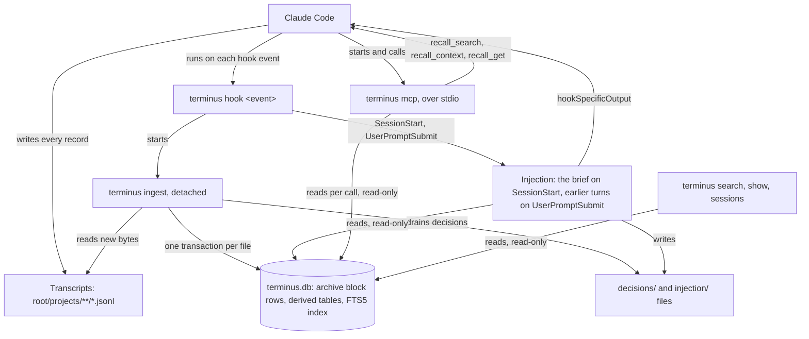

# 0001: Overview

*Figure 1. The whole system. Claude Code writes its transcripts and runs `terminus hook` on each hook event. The hook starts a detached `terminus ingest`, which copies the new bytes of each transcript into `terminus.db` and indexes them. On `SessionStart` and `UserPromptSubmit` the hook also runs injection, which reads the store and hands text back to Claude Code. Claude Code starts `terminus mcp` and calls its three recall tools, which read the same store. The terminal commands read it too. The ingest writes the database, and so do `terminus reindex`, `compact`, `observations regenerate` and `data move`, each under `LOCK`.*

## What Terminus is made of

Terminus is one Rust workspace with two crates, built into one binary, `terminus`. The binary has three jobs, picked by its first argument:

- **The hook.** Claude Code runs `terminus hook <event>` on `SessionStart`, `UserPromptSubmit`, `SessionEnd` and `PostCompact`. The hook starts `terminus ingest` in the background, reads the event's payload, and on the first two events may hand text back. It never writes the database.
- **The MCP server.** Claude Code starts `terminus mcp` and talks to it over stdin and stdout until stdin closes. It serves exactly three tools, `recall_search`, `recall_context` and `recall_get`, and opens the store read-only for each call.
- **The CLI.** Every other command: `ingest`, `backfill`, `search`, `show`, `sessions`, `verify`, `reindex`, `status`, `compact`, `usage`, `export`, `stats`, `observations`, `replay`, `retention`, `doctor`, `install`, `uninstall` and `data move`. Every option is in [commands.md](../commands.md).

The archived session is the record. Each session's transcript is stored as compressed block rows, byte for byte under the default `[capture] mode` of `full`, and everything else in the store, the turns, the full-text index, the entities and paths, is derived from those rows and can be rebuilt from them.

### `crates/terminus`, the binary

| Module | What it does |
|---|---|
| [`crates/terminus/src/lib.rs`](../../crates/terminus/src/lib.rs) | Parses the command line with `lexopt` and holds `USAGE`, the command list `terminus` prints. Maps each failure to its exit code: 1 for an operational failure, 2 for misuse. |
| [`crates/terminus/src/main.rs`](../../crates/terminus/src/main.rs) | The entry point, which calls into `lib.rs`. |
| [`crates/terminus/src/cmd/`](../../crates/terminus/src/cmd/) | One module per command, plus `spawn.rs`, which starts the detached ingest, and `read.rs`, the read-only open every read command shares. |
| [`crates/terminus/src/cmd/json.rs`](../../crates/terminus/src/cmd/json.rs) | The one `--json` envelope, `{command, ok, reason, data}`, built with `serde_json` and never by hand. Its fields and the exit codes are in [json-shapes.md](../json-shapes.md). |
| [`crates/terminus/src/out.rs`](../../crates/terminus/src/out.rs) | Every write to stdout, so a reader that closes the pipe early does not make the binary panic. |
| [`crates/terminus/src/escape.rs`](../../crates/terminus/src/escape.rs) | Spells every control character other than tab and newline as `\u00XX` in the human output of `search`, `show` and `observations`, so archived text cannot drive the reader's terminal. The store, `--json` and the record body `show` prints are left as they are. |

### `crates/terminus-core`, the library

| Module | What it does |
|---|---|
| [`store/`](../../crates/terminus-core/src/store/) | The SQLite store: resolving the data directory, opening `terminus.db` behind the format check, the schema, and the rolling snapshots. |
| [`blob/`](../../crates/terminus-core/src/blob/) | The codec that cuts a session's bytes into blocks and compresses each one into a block row. |
| [`ingest/`](../../crates/terminus-core/src/ingest/) | The ingest pass, the `LOCK` file, and the backfill that spreads the work across threads. |
| [`discover.rs`](../../crates/terminus-core/src/discover.rs) | Finds every transcript under the configured roots. |
| [`parse/`](../../crates/terminus-core/src/parse/) | Splits a transcript's new bytes into records and finds where the next pass resumes. |
| [`capture.rs`](../../crates/terminus-core/src/capture.rs) | How much of each record the archive keeps, by capture mode. |
| [`project.rs`](../../crates/terminus-core/src/project.rs) | Turns a record's `cwd` into a project key through git. |
| [`lineage.rs`](../../crates/terminus-core/src/lineage.rs) | Records which session a transcript continues from. |
| [`derive.rs`](../../crates/terminus-core/src/derive.rs) | The one place a derived row is written, used by ingest and rebuild alike. |
| [`index/`](../../crates/terminus-core/src/index/) | What a turn puts in the full-text index: its text, the expansion tokens and its entities. |
| [`recall/`](../../crates/terminus-core/src/recall/) | The query layer the terminal commands and the MCP server share: query, scope, search, context, get and excerpt. |
| [`inject/`](../../crates/terminus-core/src/inject/) | The two injection arms, the resume brief and the per-prompt injection, with their scratch and decision files. |
| [`feedback/`](../../crates/terminus-core/src/feedback/) | Drains decision files into the store, labels each decision once its session is over, and computes `stats` and `replay`. |
| [`observe/`](../../crates/terminus-core/src/observe/) | Mechanical observations of each closed session, and the egress filter on what recall returns. |
| [`retention/`](../../crates/terminus-core/src/retention/) | What each project keeps, when retention is configured. It is off by default. |
| [`recover.rs`](../../crates/terminus-core/src/recover.rs), [`reindex.rs`](../../crates/terminus-core/src/reindex.rs), [`verify.rs`](../../crates/terminus-core/src/verify.rs) | Recovery at the top of each ingest pass, the rebuild of the derived tables from the block rows, and the check of every block against its hash. |
| [`config.rs`](../../crates/terminus-core/src/config.rs) | Loads `terminus.toml` and resolves the config directory. |
| [`owner_only.rs`](../../crates/terminus-core/src/owner_only.rs) | Creates every directory `0700` and every file `0600`, with the mode set in the call that creates it. |
| [`error.rs`](../../crates/terminus-core/src/error.rs) | The crate's error type. |

The binary owns everything a user or Claude Code sees: arguments, stdout, stderr, exit codes and the JSON on the wire. The library owns everything about the store and what is in it, and knows nothing about the wire.

## The data directory

The data directory is resolved once when a command starts, then passed down, never worked out again. It comes from the first of these that gives an answer:

1. `TERMINUS_DATA_DIR`, when it is set and not empty.
2. The `data-location` pointer, a plain text file in the config directory holding one absolute path. `terminus data move` writes it and nothing else does. A pointer that exists but cannot be read, or that names a relative path, is an error rather than a fall-through, so a moved store never quietly gets a second store beside it.
3. The platform location: `$XDG_DATA_HOME/terminus` or `~/.local/share/terminus` on Linux, and `~/Library/Application Support/terminus` on macOS.

It holds:

| Path | What it is |
|---|---|
| `terminus.db` | The SQLite store, in WAL mode, so `terminus.db-wal` and `terminus.db-shm` sit beside it. |
| `LOCK` | The ingest lock. An ingest pass takes an OS lock on it without waiting, and the lock is released when the pass ends or its process dies. |
| `snapshots/` | Rolling copies of the store, taken with `VACUUM INTO` after an ingest pass when one is due. |
| `injection/` | One scratch file per session, which injection reads and writes. |
| `decisions/` | One file per injection decision, written by the prompt injection and moved into the store by the next ingest pass. |

Everything Terminus creates there is readable only by the user who runs it: [`crates/terminus-core/src/owner_only.rs`](../../crates/terminus-core/src/owner_only.rs) creates directories `0700` and files `0600`, and every creation site goes through it.

## The config file

`terminus.toml` sits in the config directory, which is `TERMINUS_CONFIG_DIR` when that is set and not empty, then `$XDG_CONFIG_HOME/terminus`, then `~/.config/terminus`, on Linux and macOS alike. A missing file gives the defaults. [`crates/terminus-core/src/config.rs`](../../crates/terminus-core/src/config.rs) loads it, and every key and its default is in [configuration.md](../configuration.md).

The transcripts Terminus reads are the `projects` folder of each Claude Code config directory. The `roots` key lists those directories; with no `roots`, it is `$CLAUDE_CONFIG_DIR`, and without that, `~/.claude`.

## Format versions

The `meta` table holds two integers, and every open of the store checks them against the build.

- `ARCHIVE_FORMAT` is 2. It changes only when the archived bytes change meaning. A store in any other archive format is refused, never converted.
- `DERIVED_SCHEMA` is 5. It changes whenever anything that can be rebuilt from the archive changes shape. A store whose derived schema differs gets its derived tables rebuilt from the block rows at the start of the next ingest pass.

Both are defined in [`crates/terminus-core/src/store/open.rs`](../../crates/terminus-core/src/store/open.rs). The archive doc, 0004, gives the tables each one covers.

## Processes and threads

There is no daemon. The hook is the scheduler: each hook event starts an ingest, and the ingest exits when its pass is done. The hook starts it through a double fork, so the ingest outlives the hook even when Claude Code kills the hook. A pass that finds `LOCK` already held exits 0 without writing anything, so ingests started at the same time collapse into one pass.

The store has one writer at a time, the process that holds `LOCK`: an ingest, or `terminus reindex`, `compact`, `observations regenerate` or `data move`. The MCP server, injection and the terminal read commands open it read-only and read beside a running pass under WAL.

Terminus links no async runtime and no thread-pool crate, `rayon` included. In the library, threads start in one place only, `ingest::backfill`, reached through `terminus backfill`: a fixed number of `std::thread` workers read and compress transcripts, and exactly one thread owns the SQLite connection and makes every write. A hook-started `terminus ingest` starts no thread. The binary starts short-lived threads in two more places: the hook reads stdin on one thread and runs injection on another, so it can stop waiting at a deadline, and `terminus install` drains the stderr of `claude mcp` on one while it runs.

## The parts

Each part has a doc of its own, in the form of [TEMPLATE.md](TEMPLATE.md).

| Doc | What it covers |
|---|---|
| [0002: Hooks](0002-hooks.md) | The four hook events, the detached spawn, the bounded read of the payload, and what the hook may write back. |
| [0003: Ingest](0003-ingest.md) | One ingest pass from the lock to the snapshot: recovery, discovery, the per-file transaction, observations, retention and the backfill. |
| [0004: The archive and its block rows](0004-archive-and-block-rows.md) | The schema, the block rows and their hashes, and the commands that check, rebuild, compact, export and move the store. |
| [0005: Search](0005-search.md) | What a turn puts in the index, how a query is ranked and scoped, and the terminal `search`, `show` and `sessions`. |
| [0006: Recall through MCP](0006-recall-through-mcp.md) | The stdio JSON-RPC server, its three tools and what each returns, and the egress filter. |
| [0007: Injection](0007-injection.md) | The resume brief, the per-prompt injection, the decision log, labels, `stats` and `replay`. |
| [0008: Install and release](0008-install-and-release.md) | `install.sh`, `terminus install`, `doctor` and `uninstall`, and how a release is built, signed and checked. |
