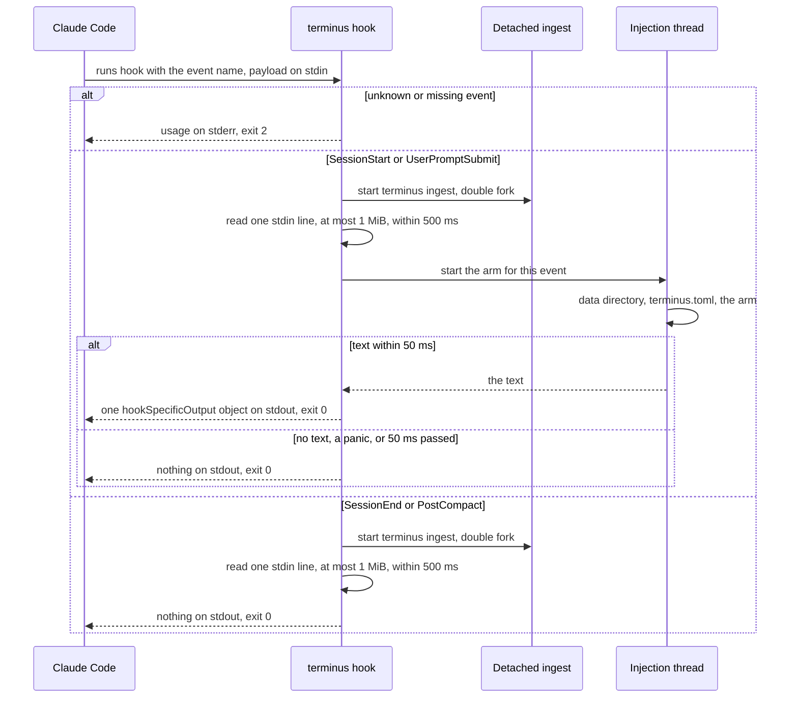
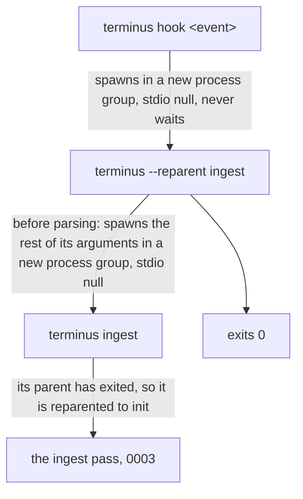

# 0002: Hooks

## 1. Purpose and scope

The hook is the command Claude Code runs on each of four events: `terminus hook <event>`. It has two jobs. The first is to start an ingest pass in the background, which makes the hook the only scheduler Terminus has. The second, on two of the four events, is to hand Claude Code a piece of text to put in the model's context.

The hook does not ingest anything itself, does not write SQLite, and never takes `LOCK`. It does not decide what text to hand over: it runs the injection arm for its event on a thread, under a deadline, and writes what comes back.

It takes work from Claude Code, which runs it with the event name as its argument and the event's payload on stdin. It hands work to the ingest pass in [0003: Ingest](0003-ingest.md), which it starts detached, and to the two injection arms in [0007: Injection](0007-injection.md), which it runs on a thread. The entries in Claude Code's `settings.json` that make Claude Code run it are written by `terminus install`, in [0008: Install and release](0008-install-and-release.md).

## 2. Terms

| Term | Meaning |
|---|---|
| Event | One of the four names in `EVENTS`: `SessionStart`, `UserPromptSubmit`, `SessionEnd` and `PostCompact`. The hook answers to no other name. |
| Payload | The one line of JSON Claude Code writes to the hook's stdin. The hook reads five of its fields and ignores the rest. |
| Arm | The injection function for an event. `SessionStart` has the resume brief and `UserPromptSubmit` has the per-prompt injection. `SessionEnd` and `PostCompact` have none. |
| Detached ingest | The `terminus ingest` process the hook starts. It is not the hook's child by the time it does any work, so it outlives the hook. |
| Hand-off | The intermediate process between the hook and the detached ingest, marked by `--reparent` as its first argument. |
| Stable path | `~/.local/bin/terminus`, the path every hook entry runs. It is a link that `terminus install` points at the current version. |
| `hookSpecificOutput` | The one JSON object the hook may write to stdout, carrying `hookEventName` and `additionalContext`. |

## 3. Crate, modules and boundaries

The hook lives in the binary crate, `crates/terminus`. It calls into `crates/terminus-core` only for the data directory, the config and the two injection arms.

| Module | What it does |
|---|---|
| [`crates/terminus/src/cmd/hook.rs`](../../crates/terminus/src/cmd/hook.rs) | `EVENTS`, the event-name parse, the payload read under `MAX_PAYLOAD` and `DRAIN_DEADLINE`, the injection thread under `INJECT_DEADLINE`, and the one write to stdout. |
| [`crates/terminus/src/cmd/spawn.rs`](../../crates/terminus/src/cmd/spawn.rs) | Starts a command detached by a double fork, through the `--reparent` hand-off, using `std` alone. `HANDOFF` is the marker. |
| [`crates/terminus/src/lib.rs`](../../crates/terminus/src/lib.rs) | Checks for the hand-off before it parses any argument, and maps the hook's misuse failure to exit 2. |
| [`crates/terminus/src/cmd/install/targets.rs`](../../crates/terminus/src/cmd/install/targets.rs) | Writes one `settings.json` entry per name in `EVENTS`. It reads the same list the parse reads, so the settings file cannot come to hold an event the binary rejects. |

The boundaries:

- **To [0003: Ingest](0003-ingest.md).** The hook starts `terminus ingest` with no other argument, on every event, before it reads stdin. Nothing else crosses: the ingest finds its own work by walking the transcript roots, so the hook passes it no session, path or event. When several hooks fire at once, the ingest's `LOCK` collapses their passes into one, and the hook does not need to know that another hook fired.
- **To [0007: Injection](0007-injection.md).** On `SessionStart` the hook runs `inject::brief::session_start`, and on `UserPromptSubmit` it runs `inject::prompt::user_prompt_submit`. Each gets the data directory, the loaded config and the five payload fields, and returns text or nothing. The hook owns the thread and the deadline. Injection owns what the text says, the read-only store it opens, and the files it writes under `injection/` and `decisions/`.
- **To [0008: Install and release](0008-install-and-release.md).** `terminus install` writes the four `settings.json` entries through `targets.rs` and starts its backfill through the same detached spawn, from the stable path. The hook never writes `settings.json`.

## 4. Records

The hook owns no table and writes no file. Its records are the three things that cross between it and Claude Code.

| Record | Kind | What it holds |
|---|---|---|
| The payload | One line of JSON on stdin | The hook reads `session_id`, `transcript_path`, `cwd`, `prompt` and `source`. `prompt` arrives on `UserPromptSubmit` only, and `source` on `SessionStart` only, as one of `startup`, `resume`, `clear`, `compact` or `fork`. `PostCompact` carries `trigger`, not `source`. Real payloads for every event are in [`tests/fixtures/hooks/`](../../tests/fixtures/hooks/), including the `SessionStart` with `source` `compact` that follows a compaction. |
| The `settings.json` entry | One JSON object per event in Claude Code's `settings.json` | `{"type":"command","command":"<stable path>","args":["hook","<event>"]}`, inside a group with `matcher: ""` under `.hooks.<event>`. It is exec form, so Claude Code runs the binary directly with those arguments and no shell. |
| The output | At most one JSON object on stdout | `{"hookSpecificOutput":{"hookEventName":"<event>","additionalContext":"<text>"}}`, on one line, built with `serde_json`. Only `SessionStart` and `UserPromptSubmit` write it. |

Every payload field is optional. A payload that is not JSON, is not an object, or holds a field that is not a string reads as those fields being absent, and an absent field means less injection, never an error. The payload is not stored: the archive reads the transcript itself, in [0003: Ingest](0003-ingest.md).

The files the injection thread writes, the session's state under `injection/` and the decision under `decisions/`, are injection's records and are described in [0007: Injection](0007-injection.md).

## 5. Commands and operations

### `terminus hook <event>`

Claude Code runs this. No one types it. Its options and exit codes are in [commands.md](../commands.md#terminus-hook-event) and [json-shapes.md](../json-shapes.md#exit-codes).

- **Inputs:** one event name from `EVENTS` as the only argument, and the payload on stdin.
- **Outputs:**
  1. It starts `terminus ingest` detached. This comes first and before stdin is touched, so a writer that never closes stdin cannot stop the ingest from starting. A spawn that fails is one line on stderr, and the hook goes on.
  2. It reads one line of stdin, up to the first `\n`, on a thread it never joins. The read stops at `MAX_PAYLOAD`, which is 1 MiB, and the hook waits for it at most `DRAIN_DEADLINE`, which is 500 ms. A line cut off at the cap stops being JSON and reads as an empty payload. A writer that holds stdin open past the deadline gets one line on stderr and an empty payload. All four events read stdin.
  3. On `SessionStart` and `UserPromptSubmit` it starts a second thread, which it also never joins, to resolve the data directory, load `terminus.toml` and run the event's arm. It waits for that thread at most `INJECT_DEADLINE`, which is 50 ms. Past the deadline it writes nothing and says so on stderr. A panic in the arm is caught and becomes no injection. Loading the config happens inside the thread, so a `terminus.toml` that does not parse is one event with no injection.
  4. When the arm returns text that is not empty or whitespace, it writes one `hookSpecificOutput` object to stdout. Otherwise stdout stays empty. `SessionEnd` and `PostCompact` never write to stdout.
  5. It exits 0.
- **Refusals:** a missing event, an event name not in `EVENTS`, or a second argument exits 2 with the usage text, before anything is spawned or read. Once the event name is known, the hook exits 0 whatever happens after, because a `UserPromptSubmit` hook that exits non-zero can block the prompt the user just typed.

### The `--reparent` hand-off

A mechanism, not a command. It is left out of the usage text.

- **Inputs:** `--reparent` as the first argument, followed by the command to run, as in `terminus --reparent ingest`.
- **Outputs:** before it parses any argument, the process starts the rest of its command line detached and exits 0 at once, with nothing on stdout or stderr. The started process runs the arguments behind the marker and does not see the marker.
- **Refusals:** none. `--reparent` anywhere but first is an ordinary argument, and the command it lands in rejects it with exit 2. The marker is an argument rather than an environment variable, so no inherited environment can put an ordinary command on this path. Typing it grants nothing beyond running that command in the background.

## 6. States and workflows

### One hook invocation

*Figure 1. One run of `terminus hook`. An unknown event exits 2 before anything starts. Every known event starts the ingest first, then reads its payload. The two events with an arm may hand back one object, and the two without one never write to stdout. Every known event exits 0.*

The hook waits on its two threads with a timeout and never joins them. A blocking read on a pipe, or a blocking SQLite call, cannot be cancelled with `std`, so the hook stops waiting and lets its own exit end the thread. Neither thread leaves half-done work that matters: the stdin thread writes nothing, and the injection thread writes its files through a temp file and a rename, so an abandoned write leaves a `.tmp` file, or for a decision an empty `.json` reserved for the rename, and the ingest's drain deletes either once it is old.

### The detached spawn

*Figure 2. The double fork. The hook starts an intermediate with `--reparent` in front of the arguments. The intermediate starts the real command and exits within microseconds, so the ingest is reparented to init and belongs to no process group of the hook's.*

Claude Code kills a hook it has given up on in two ways: it sends `SIGKILL` to the hook's process group, and it walks the hook's descendants from `ps` output and kills each one. A new process group escapes the first and not the second, because a child still parented to the hook is in the walk. The intermediate's exit takes the ingest out of the walk too. Both spawns set stdin, stdout and stderr to null, so the ingest holds no end of a pipe the hook's caller reads to EOF.

The spawn uses `std::process` alone, with `process_group(0)`, and no `libc` or `nix`. The environment is inherited unchanged, which is how `TERMINUS_DATA_DIR`, `TERMINUS_CONFIG_DIR` and `CLAUDE_CONFIG_DIR` reach the ingest.

## 7. Settings

The hook itself reads no key. Its three limits, `MAX_PAYLOAD`, `DRAIN_DEADLINE` and `INJECT_DEADLINE`, are constants, and no key or environment variable changes them in a released binary.

The injection arms the hook runs read these keys, and [0007: Injection](0007-injection.md) describes what each changes there:

| Key | What it changes here |
|---|---|
| [`exclude`](../configuration.md#exclude) | An arm run in an excluded project hands back nothing. |
| [`[injection]`](../configuration.md#injection) `brief_chars` and `prompt_chars` | How much text the `SessionStart` and `UserPromptSubmit` objects may carry. |
| [`[privacy] redact_recall`](../configuration.md#privacy) | Whether the text is filtered before the hook writes it. |

The hook and the ingest it starts resolve the data directory and the config directory from the environment Claude Code runs them in, as in [the data directory](../configuration.md#the-data-directory) and [environment variables](../configuration.md#environment-variables).
