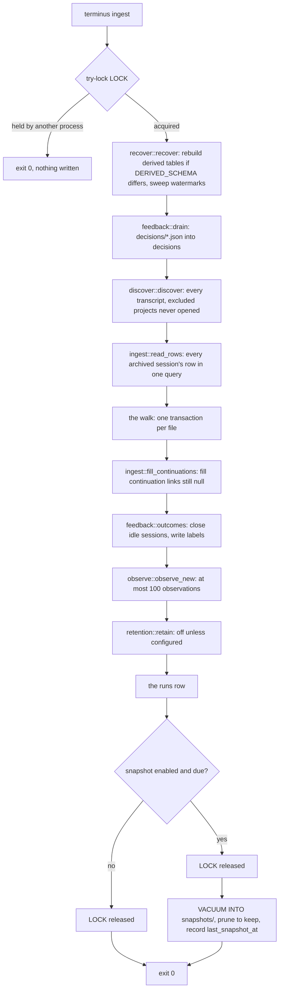
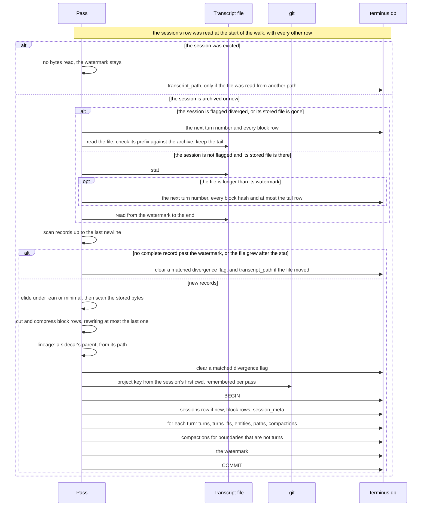
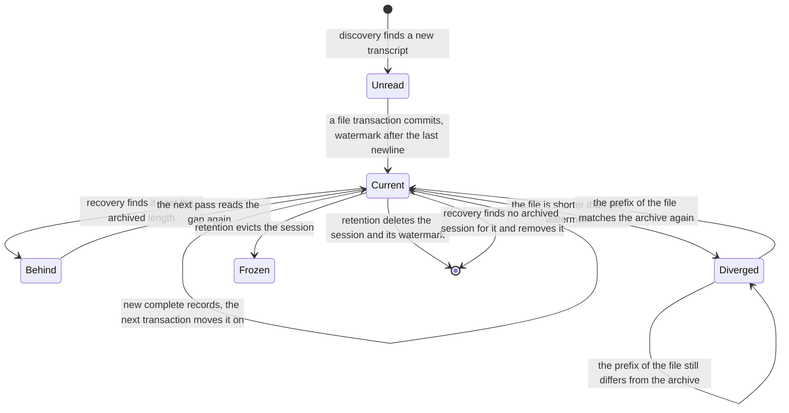

# 0003: Ingest

## 1. Purpose and scope

Ingest copies what Claude Code has appended to its transcripts into the archive, and derives everything else in the store from those bytes. One run of it is a pass: take the ingest lock, recover, drain the decision log, find every transcript, read every archived session's row in one query, archive each transcript's new bytes in a transaction of its own, then fill the continuation links still missing, close idle sessions, label their injections, record their observations, apply retention, write one `runs` row, and after the lock is released, take a rolling snapshot when one is due.

A pass reads each transcript from where the last pass stopped, so a steady-state pass reads only what is new. It does not loop, has no wall-clock bound, and does not compact the database. A pass that finds `LOCK` already held exits 0 at once, having written nothing.

It takes work from the hook in [0002: Hooks](0002-hooks.md), which starts `terminus ingest` on every hook event, and from `terminus backfill`, which `terminus install` in [0008: Install and release](0008-install-and-release.md) starts as its last step. It writes the tables described in [0004: The archive and its block rows](0004-archive-and-block-rows.md), and what it derives is what [0005: Search](0005-search.md) and the recall tools in [0006: Recall through MCP](0006-recall-through-mcp.md) read. It drains the decision files that [0007: Injection](0007-injection.md) writes, and labels those decisions once their sessions are over.

## 2. Terms

| Term | Meaning |
|---|---|
| Pass | One run of ingest over every configured transcript root, from taking `LOCK` to the `runs` row, then the snapshot step. |
| Transcript | A file discovery accepts: a `<uuid>.jsonl` directly inside a project directory, or an `agent-*.jsonl` anywhere below one. |
| Sidecar | A subagent's transcript, an `agent-*.jsonl` under `<project>/<sessionId>/subagents/`, at any depth below that. |
| Session key | A transcript's path below its project folder: `<uuid>.jsonl`, or `<sessionId>/subagents/[workflows/wf_*/]agent-*.jsonl` for a sidecar. `ingest::path_key` reads it off the shape of the path, which must sit in a project folder inside a `projects` folder, never by stripping a configured root, so a transcript reached through a moved or symlinked `.claude`, or in a moved project folder, keeps its key. A transcript that is a symlink takes the key of the file it points at. A path outside those two shapes, such as a file under no `projects` folder, keeps its canonical path as its key. Each file is one session, keyed on its path before any byte is read and never on the `sessionId` its records carry, because a sidecar's records carry its parent's id. The absolute path the file was last read from is `session_meta.transcript_path`. |
| Watermark | How many bytes of a transcript file the archive has taken, stored in `watermarks` under the session key, in the column named `transcript_path`. It always sits just past the last `\n` the pass read, so a line still being written is not archived until it is complete. |
| Capture mode | How much of each record the archive stores, from `[capture] mode`: `full`, `lean` or `minimal`. Only `full` stores the transcript byte for byte. |
| Elision | What `lean` and `minimal` do to a record: the top-level `toolUseResult` or `attachment` value is replaced with a `terminusElided` mark giving its size. Nothing else in the record changes. |
| Final | A session whose last turn is more than `IDLE_HOURS`, 6 hours, old. `feedback::outcomes` sets `session_meta.is_final`, and a final session gets its labels and its observation. |
| Divergence flag | `session_meta.transcript_diverged`, set when a transcript is shorter than its watermark. A flagged session's file is compared against the archived prefix on every pass, and the flag clears only when the two match. `terminus verify` reports it. |

## 3. Crate, modules and boundaries

The pass and every step in it live in the library crate, `crates/terminus-core`. The binary crate, `crates/terminus`, holds the commands that start a pass or report on one.

| Module | What it does |
|---|---|
| [`crates/terminus-core/src/ingest/mod.rs`](../../crates/terminus-core/src/ingest/mod.rs) | One transcript: reads the session's stored state, prepares the new bytes outside any transaction, then applies them in one transaction. Also `terminus ingest <path.jsonl>`, and `fill_continuations`, the tree pass's sweep that links a session to a `parentUuid` predecessor archived after it. |
| [`crates/terminus-core/src/ingest/pass.rs`](../../crates/terminus-core/src/ingest/pass.rs) | The pass over the whole tree, in the order in section 6, and the snapshot step. |
| [`crates/terminus-core/src/ingest/driver.rs`](../../crates/terminus-core/src/ingest/driver.rs) | The one driver every ingest runs through: it takes `LOCK`, runs recovery, reads the rows, runs the walk it is handed, records each file's failure, and writes the `runs` row. A tree pass, a backfill and `terminus ingest <path.jsonl>` each hand it a walk of their own. |
| [`crates/terminus-core/src/ingest/runs.rs`](../../crates/terminus-core/src/ingest/runs.rs) | The `runs` row's insert, and the reader of the last row that `terminus status` and `terminus doctor` share. |
| [`crates/terminus-core/src/ingest/lock.rs`](../../crates/terminus-core/src/ingest/lock.rs) | `LOCK`: an OS lock taken with `File::try_lock`, which fails at once rather than waiting, and which the OS releases when the process dies. |
| [`crates/terminus-core/src/ingest/backfill.rs`](../../crates/terminus-core/src/ingest/backfill.rs) | The same walk spread across `std::thread` workers, with one thread owning the SQLite connection and making every write. |
| [`crates/terminus-core/src/recover.rs`](../../crates/terminus-core/src/recover.rs) | Recovery at the top of every pass: rebuilds the derived tables when the store's derived schema differs from the build's, and sweeps the watermarks. |
| [`crates/terminus-core/src/discover.rs`](../../crates/terminus-core/src/discover.rs) | Walks each root's `projects` folder and returns every transcript, sorted, without opening any of them. Never lists an excluded project's directory. |
| [`crates/terminus-core/src/parse/mod.rs`](../../crates/terminus-core/src/parse/mod.rs) | Splits a byte range on `\n`, never trimming, into records, and finds the resume offset just past the last `\n`. |
| [`crates/terminus-core/src/parse/record.rs`](../../crates/terminus-core/src/parse/record.rs) | Classifies one line. A record is a turn when it has both `uuid` and `timestamp` and its type is `user`, `assistant`, `attachment` or `system`. Every other line is kept in the bytes and makes no turn. |
| [`crates/terminus-core/src/capture.rs`](../../crates/terminus-core/src/capture.rs) | Elision under `lean` and `minimal`. `lean` elides a subtree only when it is over `LEAN_THRESHOLD_BYTES`, 8,192 bytes. Under `full` it does not look at the bytes. |
| [`crates/terminus-core/src/project.rs`](../../crates/terminus-core/src/project.rs) | Turns a session's first `cwd` into its project key with `git rev-parse --show-toplevel`, under `GIT_BUDGET`, 2 seconds, folding a worktree into its parent repository. Without an answer from git, the key is the `cwd` itself. Answers are remembered for the length of one pass. |
| [`crates/terminus-core/src/lineage.rs`](../../crates/terminus-core/src/lineage.rs) | Which session a transcript continues from, by session id, and a sidecar's parent, from its path. |
| [`crates/terminus-core/src/derive.rs`](../../crates/terminus-core/src/derive.rs) | The one place a derived row is written: `derive_turn` for a turn's rows and `derive_boundary` for a compaction boundary that is not a turn. `terminus reindex` calls the same functions. |
| [`crates/terminus-core/src/feedback/mod.rs`](../../crates/terminus-core/src/feedback/mod.rs) | `feedback::drain`, which moves the decision files into `decisions`, and `feedback::outcomes`, which closes idle sessions and labels their decisions. |
| [`crates/terminus-core/src/feedback/finalize.rs`](../../crates/terminus-core/src/feedback/finalize.rs) | Marks a session final once its last turn is more than `IDLE_HOURS` old, in one `UPDATE`. A final session is never made not final. |
| [`crates/terminus-core/src/retention/mod.rs`](../../crates/terminus-core/src/retention/mod.rs) | `retention::retain`: evaluates the `[retention]` rule against one reading of the clock, then applies it. With retention off it runs no query. The evaluation names a session for deletion only when a stat of its stored `transcript_path` fails with not-found. |
| [`crates/terminus-core/src/retention/apply.rs`](../../crates/terminus-core/src/retention/apply.rs) | Evicts or deletes the sessions the evaluation named, one transaction per session. Before each delete it reads the session's `transcript_path` again inside that delete's transaction, and a session whose transcript is back on disk is kept and counted in a line in `runs.notes`. |
| [`crates/terminus-core/src/observe/mod.rs`](../../crates/terminus-core/src/observe/mod.rs) | `observe::observe_new`, which writes one observation for each newly final session, at most `MAX_PER_PASS`, 100, per pass, and the unbounded `regenerate`. |
| [`crates/terminus-core/src/observe/mechanical.rs`](../../crates/terminus-core/src/observe/mechanical.rs) | The facts in an observation. Files read and modified come from the session's `paths` rows joined to `turns.tool_name`, tools and errors from the `entities` rows of the session's own turns, the branch, the first and last turn time and the duration from `session_meta`, and the turn and compaction counts from `turns` and `compactions`. Commands with their arguments and commit subjects come from one decompression and rescan of the session stream. No model is called. |
| [`crates/terminus-core/src/store/snapshot.rs`](../../crates/terminus-core/src/store/snapshot.rs) | Takes a snapshot with `VACUUM INTO` into a temporary name, renames it into `snapshots/`, and prunes the oldest past `keep`. |
| [`crates/terminus/src/cmd/ingest.rs`](../../crates/terminus/src/cmd/ingest.rs) | `terminus ingest` and `terminus ingest <path.jsonl>`. Prints skipped files and snapshot notes on stderr. |
| [`crates/terminus/src/cmd/backfill.rs`](../../crates/terminus/src/cmd/backfill.rs) | `terminus backfill`: the estimate, then a detached `terminus backfill --work` that runs the pass across `WORKERS`, 4, workers. |
| [`crates/terminus/src/cmd/retention.rs`](../../crates/terminus/src/cmd/retention.rs) | `terminus retention --dry-run`: the same evaluation the pass runs, reported and never applied. |
| [`crates/terminus/src/cmd/observations.rs`](../../crates/terminus/src/cmd/observations.rs) | `terminus observations` and `terminus observations regenerate`. |
| [`crates/terminus/src/cmd/status.rs`](../../crates/terminus/src/cmd/status.rs) | `terminus status`: what the store holds, how far the watermarks have read, and the last `runs` row. It takes no lock. |

The boundaries:

- **From [0002: Hooks](0002-hooks.md).** The hook starts `terminus ingest` with no other argument, detached, on every event. Nothing else crosses. Concurrent hooks start concurrent passes, and `LOCK` lets one of them run.
- **To [0004: The archive and its block rows](0004-archive-and-block-rows.md).** The pass writes the store under `LOCK`, which `terminus reindex`, `compact`, `observations regenerate` and `data move` also take before they write it. It writes the archive tables, the derived tables and the operational tables there, and calls the codec in `crates/terminus-core/src/blob/` to cut and compress the block rows.
- **To [0005: Search](0005-search.md).** `derive.rs` calls `index::project` for the text a turn puts in `turns_fts`, and `index::entities` for its entity and path rows. What goes into the text, the expansion tokens and the entities is 0005's.
- **From and to [0007: Injection](0007-injection.md).** The prompt injection writes one file per decision under `decisions/` because it may not write SQLite. `feedback::drain` moves them into `decisions`, and `feedback::outcomes` labels them. What a label means is 0007's.

## 4. Records

What the pass writes, and where. The columns of every table are in [0004: The archive and its block rows](0004-archive-and-block-rows.md).

| Record | Kind | What it holds |
|---|---|---|
| `LOCK` | File in the data directory | Nothing. Its contents mean nothing, only the OS lock on it. It is created `0600` the first time a pass runs and never truncated. |
| `sessions`, `blocks`, `session_meta` | Archive tables | One row per transcript, its compressed block rows, and what the pass learned about it: project, lineage, capture mode, checksum, length, block size, first and last turn time, and the final, evicted and divergence flags. |
| `turns`, `turns_fts`, `entities`, `paths`, `compactions` | Derived tables | One `turns` row per turn, its full-text row, its entities and paths, and one `compactions` row per compaction boundary. |
| `watermarks` | Operational table | One row per session key: the byte offset the next pass reads from. |
| `runs` | Operational table | One row per run that takes `LOCK` and gets past recovery, whether a pass, a backfill or a named file, written whatever happened after recovery. A run whose recovery fails, such as one whose store cannot be opened, writes none. The row holds the start and finish, the files walked, committed and failed, the bytes read, the turns added, and two text fields, `error` for what went wrong and `notes` for what a healthy pass did worth saying. There is no log file, and `terminus status` reads this row. |
| `decisions/*.json` | Files in the data directory | The decision files the prompt injection wrote. The drain inserts each into `decisions` and deletes the file. |
| `decisions`, `labels` | Kept tables | The drained decisions, and the labels `feedback::outcomes` writes for the decisions of final sessions. |
| `observations` | Kept table | One row per final session, inserted by `observe::observe_new` and never overwritten by a pass. `terminus reindex` does not rebuild it, and `terminus observations regenerate` is the only way to. |
| `snapshots/terminus-<time>.db` | Files in the data directory | Rolling copies of the store, named by the time SQLite reports, so their names sort by age. The time of the last one is the `meta` key `last_snapshot_at`. |

## 5. Commands and operations

Options are in [commands.md](../commands.md#archiving), and the `--json` fields and exit codes are in [json-shapes.md](../json-shapes.md).

### `terminus ingest`

- **Inputs:** the config's transcript roots and exclusions, the transcripts on disk, the `decisions/` files, and the store.
- **Outputs:** one pass, in the order in section 6. Each file's failure is printed on stderr with its path and the pass goes on. Notes from the snapshot step go to stderr too, because they come after the `runs` row is written. Nothing goes to stdout.
- **Refusals:** a held `LOCK` exits 0 having done nothing. A pass that cannot run at all, such as one whose store is in an archive format this build refuses, exits 1.

### `terminus ingest <path.jsonl>`

- **Inputs:** one transcript path.
- **Outputs:** canonicalizes the path, takes `LOCK`, runs `recover::recover`, and archives that one file in one transaction. Then it writes one `runs` row, whether the file was committed, already up to date or failed: recovery's lines go in its `notes`, and a file that failed is named under `error`. The command exits 1 on such a file and does not flag it diverged. It does not drain decisions, fill continuation links, close sessions, label, observe, apply retention or take a snapshot. Those are steps of the whole-tree pass.
- **Refusals:** a file inside an excluded project is not opened. The command names the project on stderr and exits 0. A held `LOCK` exits 0.

### `terminus backfill`

- **Inputs:** the same roots, transcripts and store as a pass.
- **Outputs:** first an estimate, read-only and without creating a store: how many transcripts there are, how many bytes sit past their watermarks, and a time at a measured rate for `WORKERS`, 4, workers. Then it starts `terminus backfill --work` detached through the double fork in [0002: Hooks](0002-hooks.md) and returns. `terminus install` starts it the same way, from the stable path.
- **The work:** the detached process takes `LOCK`, runs `recover::recover` and `discover::discover`, then walks the transcripts in rounds of `QUEUE_PER_WORKER`, 2, files per worker. The `std::thread` workers each read a file past its watermark, scan it, elide it and compress it into block rows. The one writer thread owns the SQLite connection, applies each prepared file in discovery order, one transaction per file, and writes the one `runs` row, the row a tree pass writes, `notes` included. A backfill and a sequential pass over the same tree archive the same `sessions` rows, block rows, checksums and watermarks, and the same bytes in every block. Their `session_meta` rows match except in two columns that only the tree pass's steps after the walk write: `is_final`, which `feedback::outcomes` sets, and `continues_from` for a session archived before its `parentUuid` predecessor, which the continuation sweep fills. Their `runs` rows differ too. A backfill does not drain decisions, fill continuation links, label, observe, apply retention or take a snapshot; the next pass a hook starts does.
- **Refusals:** a held `LOCK` exits the working process 0. A hook that fires during a backfill finds `LOCK` held and exits 0. `--work` is left out of the usage text, and typing it runs the pass in the foreground.

### `terminus retention --dry-run`

- **Inputs:** the `[retention]` rules and the store, opened read-only.
- **Outputs:** what the next pass would evict and delete under the current rule, measured from one reading of SQLite's clock, which the report includes. It calls `retention::evaluate`, the same function `retention::retain` calls, so the report and the pass cannot disagree about the rule.
- **Refusals:** none. It changes nothing, with or without `--dry-run`.

### `terminus observations`

- **Inputs:** the project scope, as in [0005: Search](0005-search.md), and the store, opened read-only.
- **Outputs:** the observation of each final session in the project, listed through the same visibility check every read uses, so an excluded project's sessions never appear.
- **Refusals:** none beyond the read commands' own.

### `terminus observations regenerate`

- **Inputs:** `--since`, and the store.
- **Outputs:** recomputes the `mechanical` column of the observations already recorded, from the block rows, with no per-pass limit. A session whose block rows retention evicted cannot be recomputed and is named on stderr.
- **Refusals:** it takes `LOCK`, and exits 1 when another process holds it.

### `terminus status`

- **Inputs:** the store.
- **Outputs:** the store's path and size, the visible sessions and turns, how many bytes the watermarks have read, the excluded projects, and the last `runs` row in full.
- **Refusals:** none. It takes no lock, so it works while a pass runs.

## 6. States and workflows

### One pass

The pass in [`crates/terminus-core/src/ingest/pass.rs`](../../crates/terminus-core/src/ingest/pass.rs), run through the driver in [`crates/terminus-core/src/ingest/driver.rs`](../../crates/terminus-core/src/ingest/driver.rs), in order:

1. **Try-lock `LOCK`.** It fails at once if another process holds it, and then the pass exits 0 having written nothing. The lock is taken before the store is opened, so a contended run costs one file open and one system call.
2. **`recover::recover`.** Opens the store. When the `derived_schema` in `meta` differs from `DERIVED_SCHEMA`, the build's, it rebuilds every derived table from the block rows, as `terminus reindex` does, before any transcript is read. Then it sweeps the watermarks: a watermark past the bytes a `full` session's archive holds is lowered to that length, so the next read takes the gap again, and a non-zero watermark for a path with no session is removed. No archived byte is lost: a lowered watermark only makes the next read take the gap again, and a removed one claimed bytes nothing archived. Each repair becomes a line in the `runs` row's `notes`.
3. **`feedback::drain`.** First deletes `.decision-*.tmp` files under `decisions/` and `.inject-*.tmp` files under `injection/` that are more than 10 minutes old, which are writes the hook abandoned at its deadline. Then reads every `decisions/*.json`, inserts the decisions in one transaction, and deletes the files. An empty `.json` less than 10 minutes old is a write still in flight and is left for the next pass.
4. **`discover::discover`.** Walks the `projects` folder of each root, in the configured order, at any depth and including names that start with a dot. It accepts `<uuid>.jsonl` directly inside a project directory and `agent-*.jsonl` at any depth below one, which is where the `subagents/agent-*.jsonl` sidecars sit, and nothing else, by name alone. A project directory whose path is in `exclude` is never listed, so none of its files is opened. A transcript that is a symlink is resolved: one whose target sits in an excluded project is dropped and reported with the excluded projects, and one that does not resolve is reported as unreadable.
5. **The walk.** First `ingest::read_rows` reads every archived session's row in one query, as "One file in the walk" below describes. Then each transcript, in sorted order, in a transaction of its own. Before a file is read, `ingest::claim` resolves a link to the file it points at and takes that file's session key. Another path to a file the walk already took is skipped. A different file whose key an earlier file of this walk took, or whose key an archived session holds while the file that session was read from is still there, is recorded as a failure and never opened. Figure 2 shows one file. A file that fails is recorded with its path and skipped, and the walk goes on, so one damaged transcript cannot stop the rest.
6. **`ingest::fill_continuations`.** Ingest resolves a session's `continues_from` when its first turn is written, so a session archived before the session holding its first turn's `parentUuid` is left with a null link. This step selects every `session_meta` row whose `continues_from` is null and whose first turn carries a `parentUuid`, resolves that `parentUuid` by the rule ingest uses, and writes the predecessor's session id into a link that is still null, never over one already set. It runs on every tree pass, whatever the walk committed, because the predecessor may have come from a backfill or a named file, neither of which runs it.
7. **`feedback::outcomes`.** Marks final every session whose last turn is more than 6 hours old, then labels the decisions of final sessions. It runs after the walk, because a decision is judged by the turns that followed it.
8. **`observe::observe_new`.** Writes the observation of each final session that has none yet, oldest first, at most 100 per pass. The rest wait for the next pass.
9. **`retention::retain`.** With a `[retention]` rule set, evicts or deletes the final sessions it names, at most 100 per action per pass. A session is named for deletion only when a stat of its stored `transcript_path` fails with not-found, because a transcript still on disk would be found and archived again by the next pass. Each delete then reads `transcript_path` again inside its own transaction, and a session whose transcript is back on disk by then is kept and counted in a line in `notes`. That narrows the window between the evaluation and the delete without closing it, because `LOCK` guards the store and not the transcript tree. The step runs after the observations, which read the block rows an eviction removes.
10. **The `runs` row.** One row, whatever happened after recovery, holding every failure and note the steps above produced. A run whose recovery fails writes no row, because the store it would write to could not be opened or brought up to date.
11. **The snapshot.** Inside the lock, after the `runs` row has committed, the pass asks its own store whether a snapshot is due: `[snapshot] enabled`, and `last_snapshot_at` in `meta` missing or at least `interval_hours` old by SQLite's clock. Then `LOCK` is released. Only when one is due does the pass open the store again, copy it with `VACUUM INTO`, prune to `keep`, then record `last_snapshot_at`. The copy runs outside the lock, so a snapshot that fails, or a check that could not be answered, is a note on stderr and never a failed pass.

Steps 3 and 6 to 9 never fail the pass: what they could not do becomes a line in the `runs` row's `error` or `notes`.

*Figure 1. One ingest pass, from the lock to the snapshot. Everything from recovery to the `runs` row, and the check of whether a snapshot is due, runs under `LOCK`. The copy runs after the lock is released.*

### One file in the walk

Every file's stored state comes from one query at the start of the walk. `ingest::read_rows` reads each archived session's `sessions` row with its `session_meta` and `watermarks` rows: the `session_no`, the checksum, the block size, the stored length and capture mode, the stored `transcript_path`, the divergence and eviction flags, whether a sidecar's meta is already stored, and the watermark. It runs after recovery and the drain, because recovery's watermark sweep rewrites these rows. The rows stay true for the whole walk, because `claim` lets each key through once, so no file's transaction changes a row a later file reads. A transcript with no row has never been archived, and its watermark is 0. `terminus ingest <path.jsonl>` reads only its own key's row, and a backfill reads every row after recovery, as the pass does.

From the row, `Existing::read` decides what else to fetch:

- An evicted session fetches nothing, and its file is not looked at. It is never appended to.
- A session flagged diverged, or one whose stored file is gone, fetches the next turn number and every block row, for the prefix comparison below.
- Any other session, and a transcript never archived, gets one stat of its file. A file no longer than its watermark fetches nothing: no turn number, no hash and no block row. The tail read then opens it and finds nothing past the watermark, or refuses it as shorter. A failed stat fetches nothing either, and the open fails the same way. Only a file longer than its watermark fetches the next turn number and, for an archived session, every block hash and at most the tail row.

So an unchanged file costs a stat, an open and no query.

A file can grow after its stat. The tail read then finds complete records past the watermark with nothing fetched for an append, and the pass does not append without the stored hashes. Nothing is archived, the watermark stays where it was, no row is added, and the next pass, whose stat sees the growth, appends the records.

*Figure 2. One transcript in the walk. Its row was read with every other at the start of the walk, so a file no longer than its watermark costs one stat and no query. Reading, scanning, compressing and resolving the project happen outside the transaction. Everything the file adds to the store commits in one transaction, so a killed pass leaves no half-indexed session and loses at most that one file's work. Clearing the divergence flag and updating a moved file's path are single statements outside it.*

Reads happen outside the transaction and the file's archive writes inside it. That is safe because the pass holds `LOCK` and so is the only writer, and it keeps the write transaction short, so the MCP server, injection and the read commands are never held up behind compression. Two small writes are not in the file's transaction. Each is one `UPDATE` of `session_meta` that commits on its own: clearing `transcript_diverged` for a flagged session whose file matches the archive again, made before the transaction begins and whether or not there are new bytes, and setting `transcript_path` to where the file was read from, made only when there is nothing to append and the stored path is another. When there are new bytes, `transcript_path` is written with the rest of `session_meta` inside the transaction.

An append is checked before anything is cut: the stored block hashes against the session checksum, and the last block row against its hash, so a growing session cannot gain a fresh checksum over damaged bytes. A session keeps the block size it was first cut at.

A transcript shorter than its watermark fails that file and sets `transcript_diverged` in its own small transaction, so `terminus verify` can report it. That length test is the only check an unflagged session's file gets: a file no shorter than its watermark is read from the watermark on, and its earlier bytes are not compared with the archive. A flagged session's file is read whole on every pass and its first watermark bytes are compared with the archived stream. While they differ the file fails again and the flag stays set, and once they match the flag clears and the tail is appended. A session not captured under `full` never matches, because elision makes its archived stream differ from the file, so its flag stays set. A file standing in for a session whose stored file is gone gets the same comparison, and a mismatch there fails the file without setting the flag.

### Where the watermark goes

*Figure 3. The states a session's watermark passes through. Ingest moves it only inside the transaction that archives the bytes it covers. Recovery lowers one past the archived length and removes one that names no archived session.*

The sweep that finds a watermark behind applies only to sessions captured under `full`. Under `lean` and `minimal` a watermark is a file offset and the archived length is a count of stored bytes, which are smaller, so the comparison means nothing there. The watermark and the bytes still commit in one transaction under every mode.

## 7. Settings

Each key below is read once per pass. Its default and full effect are in [configuration.md](../configuration.md).

| Key | What it changes here |
|---|---|
| [`roots`](../configuration.md#roots) | Which Claude Code config directories' `projects` folders discovery walks. Empty by default, which means `$CLAUDE_CONFIG_DIR`, then `~/.claude`. |
| [`exclude`](../configuration.md#exclude) | Project directories discovery never lists, and `terminus ingest <path.jsonl>` refuses. The observation and retention steps pass over excluded sessions too. |
| [`[capture] mode`](../configuration.md#capture) | `full` by default. `lean` and `minimal` elide as records are archived, and records already stored keep what they have. |
| [`[retention]`](../configuration.md#retention) and [`[retention.project."<path>"]`](../configuration.md#retentionprojectpath) | What step 9 evicts or deletes. Off by default: nothing happens unless `action` is not `keep` and `age_days` is above 0. |
| [`[snapshot]`](../configuration.md#snapshot) | Whether step 11 runs, and when: `enabled` defaults to `true`, `interval_hours` to 24, and `keep` to 3. |

No key changes the order of the steps, the per-pass limits of 100, the 6-hour idle rule or the worker count.
