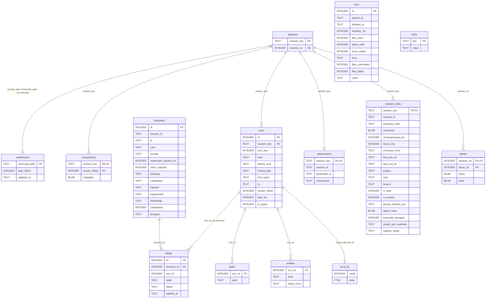
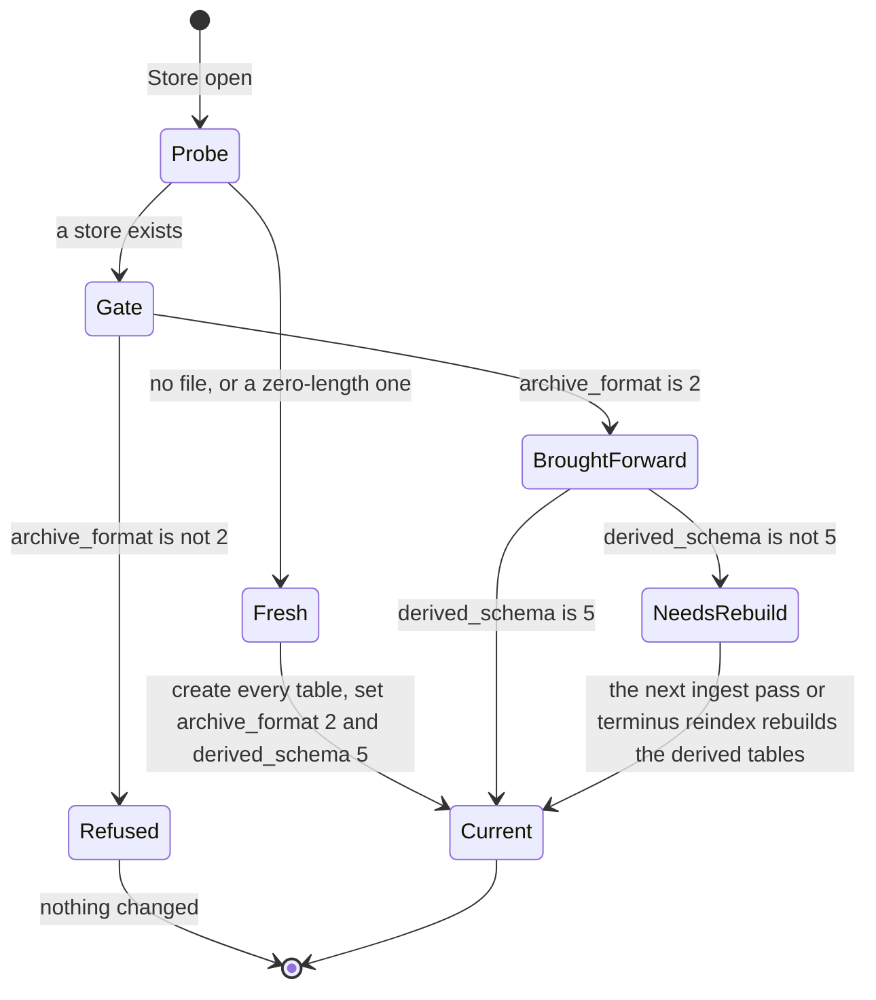
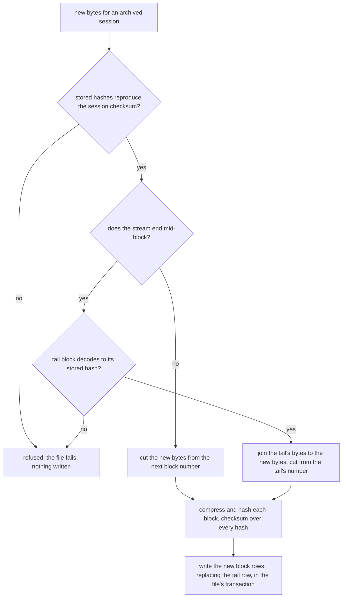

# 0004: The archive and its block rows

## 1. Purpose and scope

The archive is `terminus.db`, one SQLite file in the data directory, and the tables in it. Its core is the block rows: each session's transcript bytes, cut into fixed-size blocks, each block compressed on its own and stored as one row with a hash of its uncompressed bytes. The block rows are the record. Every other table falls into one of three groups: kept tables that hold what the archive cannot reproduce, derived tables that can be rebuilt from the block rows at any time, and operational tables that say how far ingest has read and what it did.

This doc is the one place every table and column is given. It also covers how the store is opened, how its two format versions are checked, and the commands that check, rebuild, compact, measure, export and move it.

The archive does not decide what goes into it. The ingest pass in [0003: Ingest](0003-ingest.md) is its only writer. [0005: Search](0005-search.md) and [0006: Recall through MCP](0006-recall-through-mcp.md) read it, [0007: Injection](0007-injection.md) reads it and owns what its decisions and labels mean, and `terminus uninstall --purge` in [0008: Install and release](0008-install-and-release.md) deletes the data directory that holds it.

## 2. Terms

| Term | Meaning |
|---|---|
| Session | One transcript file, keyed by `session_key`, its canonical path, and numbered by `session_no`, a stable integer assigned when it is first archived. |
| Session stream | The bytes the archive holds for one session: the transcript as it was read, byte for byte under `[capture] mode` `full`. Offsets in `turns` and `compactions` are offsets in this stream, never in a block. |
| Block row | One row of `blocks`: block `block_no` of a session's stream, compressed with zstd, with the BLAKE3 hash of its uncompressed bytes. |
| Block size | How many uncompressed bytes each block of a session holds, recorded per session in `session_meta.block_size`. New sessions are cut at `BLOCK_SIZE`, 65536. |
| Tail block | A session's last block, when it holds fewer than block-size bytes. It is the only block an append ever rewrites. |
| Session checksum | BLAKE3 over the session's block hashes, concatenated in `block_no` order, in `session_meta.checksum`. |
| Turn id | `turns.id`, which is `session_no << 24 \| turn_seq`. `turn_seq` is the turn's position in its transcript, so a rebuild gives every turn the same id. |
| Archive format | The integer `ARCHIVE_FORMAT`, 2, and the `meta` key `archive_format`. It says what the archived bytes mean. |
| Derived schema | The integer `DERIVED_SCHEMA`, 5, and the `meta` key `derived_schema`. It says what shape the derived tables are in. |
| Evicted | A session whose block rows retention deleted, marked by `session_meta.is_evicted`. Its session row, metadata and derived rows stay. |

## 3. Crate, modules and boundaries

The store lives in the library crate, `crates/terminus-core`. The commands that work on the whole store live in the binary crate, `crates/terminus`.

| Module | What it does |
|---|---|
| [`crates/terminus-core/src/store/mod.rs`](../../crates/terminus-core/src/store/mod.rs) | The store's public face: `Store`, `turn_id`, `TABLES` and `DERIVED_TABLES`. |
| [`crates/terminus-core/src/store/open.rs`](../../crates/terminus-core/src/store/open.rs) | `ARCHIVE_FORMAT` and `DERIVED_SCHEMA`, the version gate, the writable and read-only opens, bringing an older store's tables and columns forward, and resolving the data directory. |
| [`crates/terminus-core/src/store/schema.rs`](../../crates/terminus-core/src/store/schema.rs) | Every table, column and index, in one `CREATE_SQL`, and `TABLES`, `DERIVED_TABLES`, `BRING_FORWARD_COLUMNS` and the turn-id encoding. |
| [`crates/terminus-core/src/store/archive.rs`](../../crates/terminus-core/src/store/archive.rs) | Every read and write of a session's block rows. A reader asks for a range of the session stream and gets back only the blocks that range covers. It checks no hash. |
| [`crates/terminus-core/src/blob/mod.rs`](../../crates/terminus-core/src/blob/mod.rs) | `BLOCK_SIZE` and `ZSTD_LEVEL`, and the bounds on a block size read from a column. |
| [`crates/terminus-core/src/blob/block.rs`](../../crates/terminus-core/src/blob/block.rs) | The codec, pure functions over bytes with no SQL: cut a stream into blocks, hash and compress each, compute the session checksum, append to a stored session, and decompress a range. |
| [`crates/terminus-core/src/verify.rs`](../../crates/terminus-core/src/verify.rs) | Checks every session's block rows against their hashes and the session checksum. |
| [`crates/terminus-core/src/reindex.rs`](../../crates/terminus-core/src/reindex.rs) | Rebuilds every derived table from the block rows, in one transaction, and `open_up_to_date`, which does so when the derived schema differs. |
| [`crates/terminus/src/cmd/verify.rs`](../../crates/terminus/src/cmd/verify.rs) | `terminus verify`. |
| [`crates/terminus/src/cmd/reindex.rs`](../../crates/terminus/src/cmd/reindex.rs) | `terminus reindex`, under `LOCK`. |
| [`crates/terminus/src/cmd/compact.rs`](../../crates/terminus/src/cmd/compact.rs) | `terminus compact`: `VACUUM`, then `PRAGMA wal_checkpoint(TRUNCATE)`, under `LOCK`. |
| [`crates/terminus/src/cmd/usage.rs`](../../crates/terminus/src/cmd/usage.rs) | `terminus usage`: the archive's bytes by project and by month, and the file's bytes by table from SQLite's `dbstat`. |
| [`crates/terminus/src/cmd/export.rs`](../../crates/terminus/src/cmd/export.rs) | `terminus export <dir>`: one `.jsonl` per visible session and a `manifest.json`. |
| [`crates/terminus/src/cmd/data.rs`](../../crates/terminus/src/cmd/data.rs) | `terminus data move <path>`: copies the data directory under `LOCK`, records the new location, then deletes the old one. |

The boundaries:

- **From [0003: Ingest](0003-ingest.md).** The pass holds `LOCK` and is the only process that writes archive, derived and operational rows. It calls the codec to cut and compress block rows, and writes each file's rows in one transaction. `terminus reindex`, `compact`, `data move`, `observations regenerate` and `uninstall --purge` take the same lock before they write or delete.
- **To [0005: Search](0005-search.md) and [0006: Recall through MCP](0006-recall-through-mcp.md).** They open the store read-only and read `turns_fts`, `entities`, `paths`, `turns` and `session_meta`, and read a turn's bytes through `store/archive.rs`, which fetches and decompresses only the blocks the turn covers.
- **To [0007: Injection](0007-injection.md).** Injection opens the store read-only. Its decisions and their labels are kept tables here, because no rebuild from the block rows can reproduce them.
- **To [0008: Install and release](0008-install-and-release.md).** `terminus install` refuses a store in an older archive format than this build reads, and prints a problem without refusing when the format is newer, and `terminus uninstall --purge` deletes the whole data directory under `LOCK`.

## 4. Records

Every table is created by `CREATE_SQL` in [`crates/terminus-core/src/store/schema.rs`](../../crates/terminus-core/src/store/schema.rs), and `TABLES` lists all fourteen. Foreign keys are enforced: the bundled SQLite is built with them on. Figure 1 draws the same tables and how they reference each other.

### Archive tables

The truth. They are never dropped, never rebuilt and never converted.

`sessions`, one row per archived transcript:

| Column | Type | What it holds |
|---|---|---|
| `session_key` | `TEXT` primary key | The transcript's canonical path. |
| `session_no` | `INTEGER NOT NULL UNIQUE` | The session's number, the next unused one when it is first archived. Block rows and turn ids are keyed on it. |

`blocks`, one row per block of a session's stream, primary key `(session_no, block_no)`:

| Column | Type | What it holds |
|---|---|---|
| `session_no` | `INTEGER NOT NULL`, references `sessions(session_no)` | The session. |
| `block_no` | `INTEGER NOT NULL` | The block's position, from 0. |
| `bytes` | `BLOB NOT NULL` | The block, compressed with zstd at `ZSTD_LEVEL` 3. |
| `hash` | `BLOB NOT NULL` | BLAKE3 over the block's uncompressed bytes, 32 bytes. |

`session_meta`, one row per session:

| Column | Type | What it holds |
|---|---|---|
| `session_key` | `TEXT` primary key, references `sessions(session_key)` | The session. |
| `session_id` | `TEXT` | The `sessionId` the transcript's records carry. A sidecar carries its parent's. |
| `transcript_path` | `TEXT NOT NULL` | The path the transcript was read from. |
| `checksum` | `BLOB NOT NULL` | The session checksum. |
| `uncompressed_len` | `INTEGER NOT NULL` | The length of the session stream in bytes. |
| `block_size` | `INTEGER` | The block size the session was first cut at. It never changes for that session. |
| `continues_from` | `TEXT` | The session id this transcript continues from, never its own. |
| `first_turn_at` | `TEXT` | The first turn's timestamp, ISO-8601 UTC. |
| `last_turn_at` | `TEXT` | The last turn's timestamp, which the idle rule and retention measure age from. |
| `project` | `TEXT` | The project key, from the first `cwd` through git, with a worktree folded into its repository. |
| `cwd` | `TEXT` | The session's first `cwd`. |
| `branch` | `TEXT` | The git branch the records carry. |
| `is_final` | `INTEGER` | 1 once the session has been idle for 6 hours. |
| `is_evicted` | `INTEGER` | 1 once retention has deleted the session's block rows. |
| `parent_session_key` | `TEXT` | For a sidecar, the session key of the transcript it belongs to, from its path. |
| `agent_meta` | `BLOB` | A sidecar's `agent-*.meta.json`, stored as bytes and never parsed into columns. |
| `transcript_diverged` | `INTEGER` | 1 when the transcript on disk is shorter than what was archived or does not match it. `terminus verify` reports it. |
| `project_pre_worktree` | `TEXT` | The project key before a worktree was folded into its repository. |
| `capture_mode` | `TEXT` | `full`, `lean` or `minimal`. Null means `full`. |

### Kept tables

They hold what happened at prompt time, or facts read from block rows that retention may later delete, so no rebuild can reproduce them. A rebuild never drops them.

`decisions`, one row per prompt the injection logged, including prompts that injected nothing:

| Column | Type | What it holds |
|---|---|---|
| `id` | `INTEGER` primary key | The decision. |
| `session_id` | `TEXT` | The Claude Code session the prompt was in. |
| `ts` | `TEXT` | When the prompt was decided, ISO-8601 UTC. |
| `cwd` | `TEXT` | The session's working directory. |
| `prompt` | `TEXT` | The prompt. |
| `watermark_session_no` | `INTEGER` | The highest `session_no` at the time, which bounds a replay to the archive as it stood. |
| `chars_injected` | `INTEGER` | Characters injected, 0 when nothing was. |
| `spellings` | `TEXT` | JSON: what the prompt was asked about, strongest first. |
| `candidates` | `TEXT` | JSON: the scored candidate turns. |
| `injected` | `TEXT` | JSON: the turns injected and the characters each spent. |
| `suppressed` | `TEXT` | JSON: the turns refused, with the reason. |
| `thresholds` | `TEXT` | JSON: the thresholds in force. |
| `compacted` | `INTEGER` | 1 when the prompt used the pool for the first prompt after a compaction, 0 when not. Null for a decision logged before the column existed. |
| `dropped` | `TEXT` | JSON: the turn ids the compaction dropped. |

`labels`, what each decision turned out to be worth:

| Column | Type | What it holds |
|---|---|---|
| `id` | `INTEGER` primary key | The label. |
| `decision_id` | `INTEGER NOT NULL`, references `decisions(id)` | The decision. |
| `turn_id` | `INTEGER` | The injected turn a `hit` or `false positive` is about. Null for `miss` and `wasted budget`, which are about the whole decision. It has no foreign key, because `turns` is dropped by a rebuild. |
| `label` | `TEXT NOT NULL` | `hit`, `false positive`, `miss` or `wasted budget`. |
| `detail` | `TEXT` | For a `miss`, what the prompt was looking for. For `wasted budget`, the characters injected. Null for `hit` and `false positive`. |
| `labeled_at` | `TEXT` | When the label was written. |

`observations`, one row per final session:

| Column | Type | What it holds |
|---|---|---|
| `session_key` | `TEXT` primary key, references `sessions(session_key)` | The session. |
| `session_id` | `TEXT` | Its session id. |
| `generated_at` | `TEXT` | When the row was written. |
| `mechanical` | `TEXT` | JSON: the files, tools, commands, errors, branch, commits, turn count, duration and compactions. |

### Derived tables

`DERIVED_TABLES` lists them in this order: `turns`, `compactions`, `turns_fts`, `entities`, `paths`. Every row in them comes from the block rows, through [`crates/terminus-core/src/derive.rs`](../../crates/terminus-core/src/derive.rs), and `terminus reindex` drops and rebuilds them.

`turns`, one row per turn, unique on `(session_key, turn_seq)`:

| Column | Type | What it holds |
|---|---|---|
| `id` | `INTEGER` primary key | The turn id, `session_no << 24 \| turn_seq`. |
| `session_key` | `TEXT NOT NULL`, references `sessions(session_key)` | The session. |
| `turn_seq` | `INTEGER NOT NULL` | The turn's position among the session's turns, from 0. |
| `uuid` | `TEXT` | The record's `uuid`. |
| `parent_uuid` | `TEXT` | The record's `parentUuid`. |
| `record_type` | `TEXT NOT NULL` | `user`, `assistant`, `attachment` or `system`. |
| `tool_name` | `TEXT` | The tool a tool call names. |
| `ts` | `TEXT` | The record's timestamp. |
| `stream_offset` | `INTEGER NOT NULL` | Where the record starts in the session stream. |
| `byte_len` | `INTEGER NOT NULL` | The record's length in the stream. |
| `is_typed` | `INTEGER` | For a `user` turn, 1 when the person typed it and 0 when the harness wrote it. Null for every other type. |

`compactions`, one row per compaction boundary, primary key `(session_key, stream_offset)`:

| Column | Type | What it holds |
|---|---|---|
| `session_key` | `TEXT NOT NULL`, references `sessions(session_key)` | The session. |
| `stream_offset` | `INTEGER NOT NULL` | Where the `compact_boundary` record starts in the stream. |
| `metadata` | `BLOB` | The record's `compactMetadata`, as stored. |

`turns_fts`, the full-text index, an FTS5 table declared `content=''` and `contentless_delete=1`:

| Column | Type | What it holds |
|---|---|---|
| `rowid` | `INTEGER` | The turn id. |
| `body` | FTS5 column | The turn's text and its expansion tokens, as [0005: Search](0005-search.md) describes. The table is contentless, so the text can be matched and cannot be read back out. |

`entities`, the paths, commands, errors, symbols and tools a turn names:

| Column | Type | What it holds |
|---|---|---|
| `turn_id` | `INTEGER NOT NULL`, references `turns(id)` | The turn. |
| `kind` | `TEXT NOT NULL` | One of the entity kinds in [0005: Search](0005-search.md). |
| `value_norm` | `TEXT NOT NULL` | The value, normalized. |

`paths`, every path entity again, for lookups by path:

| Column | Type | What it holds |
|---|---|---|
| `turn_id` | `INTEGER NOT NULL`, references `turns(id)` | The turn. |
| `path` | `TEXT NOT NULL` | The path. |

### Operational tables

`watermarks`, one row per transcript ingest has read:

| Column | Type | What it holds |
|---|---|---|
| `transcript_path` | `TEXT` primary key | The session key. |
| `byte_offset` | `INTEGER NOT NULL` | Where the next pass reads the file from. |
| `updated_at` | `TEXT` | When it last moved. |

`runs`, one row per ingest pass:

| Column | Type | What it holds |
|---|---|---|
| `id` | `INTEGER` primary key | The pass. |
| `started_at` | `TEXT NOT NULL` | When it started. |
| `finished_at` | `TEXT` | When it finished. |
| `duration_ms` | `INTEGER` | How long it took. |
| `files_seen` | `INTEGER NOT NULL DEFAULT 0` | Transcripts discovery found. |
| `bytes_read` | `INTEGER NOT NULL DEFAULT 0` | File bytes read past the watermarks. |
| `turns_added` | `INTEGER NOT NULL DEFAULT 0` | Turns derived. |
| `error` | `TEXT` | Every failure, one per line. |
| `files_committed` | `INTEGER NOT NULL DEFAULT 0` | Transcripts that committed new bytes. |
| `files_failed` | `INTEGER NOT NULL DEFAULT 0` | Transcripts that failed and were skipped. |
| `notes` | `TEXT` | What a healthy pass did worth saying, such as labels written and sessions evicted. |

`meta`, `WITHOUT ROWID`, keyed text values:

| Column | Type | What it holds |
|---|---|---|
| `key` | `TEXT` primary key | `archive_format`, `derived_schema` or `last_snapshot_at`. |
| `value` | `TEXT NOT NULL` | The archive format, the derived schema, or the Unix seconds of the last rolling snapshot. |

### The block rows

A new session is cut into blocks of `BLOCK_SIZE`, 65536 uncompressed bytes, numbered from 0, and the size is recorded in `session_meta.block_size`. A session keeps the block size it was first cut at, so a later change to `BLOCK_SIZE` applies to new sessions and rewrites no stored row. A block size read from a column must be above 0 and at most 64 MiB, or the session is refused as damaged.

Each block is compressed on its own with zstd at `ZSTD_LEVEL` 3, and hashed with BLAKE3 over its uncompressed bytes, so a different zstd that encodes the same bytes differently fails no stored hash. The session checksum is BLAKE3 over the block hashes in `block_no` order.

Reading a turn reads its `stream_offset` and `byte_len` from `turns`, turns them into the range of blocks they cover with the session's block size, and fetches and decompresses only those rows. A read checks no hash. `terminus verify` and the append are the checkers.

An append, which is how every pass after a session's first adds to it, rewrites at most the tail block. Before it cuts anything it checks that the stored hashes reproduce the session checksum and that the tail block decodes to its stored hash, because a zstd frame here carries no checksum of its own and a flipped bit in the tail would otherwise decode cleanly and be hashed again as if it were good. Then it joins the tail's bytes to the new bytes, cuts them into blocks from the tail's number, and computes the new checksum. Complete blocks are never read or rewritten. Figure 3 shows it.

### The format versions

`meta` holds `archive_format` and `derived_schema`, and every open compares them with the build's `ARCHIVE_FORMAT`, 2, and `DERIVED_SCHEMA`, 5, before it opens a writable connection.

- An archive format other than 2, older or newer, is refused, and the store is not changed. There is no conversion.
- A derived schema other than 5, older or newer, opens and is marked as needing a rebuild. The next ingest pass rebuilds every derived table from the block rows before it reads any transcript, and `terminus reindex` does the same.
- Every writable open of an existing store creates any table in `TABLES` the store lacks and adds any column in `BRING_FORWARD_COLUMNS` it lacks, with `ALTER TABLE ADD COLUMN`. Those columns are `session_meta`'s `agent_meta`, `transcript_diverged`, `project_pre_worktree` and `capture_mode`, `runs`'s `files_committed`, `files_failed` and `notes`, `turns`'s `is_typed`, and `decisions`'s `compacted` and `dropped`. Each is declared last in its table, so a new store and a brought-forward one have the same column order. The same open drops the observation columns in `DROPPED_OBSERVATION_COLUMNS` and the `meta` key in `DROPPED_META_KEY` where a store still has them. A read-only open changes nothing and reports what is missing.

## 5. Commands and operations

Options are in [commands.md](../commands.md#the-store), and the `--json` fields and exit codes are in [json-shapes.md](../json-shapes.md).

### Opening the store

- **Inputs:** the data directory.
- **Outputs:** a writable open creates the data directory `0700` and `terminus.db` `0600` if they are not there, runs the version gate on a read-only connection, then opens a connection in WAL mode with `synchronous` `normal` and a 5-second busy timeout. A new store gets every table and both `meta` versions in one transaction. An existing one is brought forward as above. A read-only open creates nothing: with no store, the read commands give an empty answer with a reason.
- **Refusals:** an archive format other than 2, a file that is not a store, and a store with no `archive_format` or `derived_schema` in `meta`.

### `terminus verify`

- **Inputs:** the store.
- **Outputs:** for each session, three checks, and every failure is named by `session_key`: the block rows run from 0 to the count `uncompressed_len` and the block size give, with no gap; each block decodes to its length and its stored hash; and the session checksum matches the stored hashes. A session with `transcript_diverged` set is reported too, as a fact about the file on disk, with the archive intact. An evicted session is counted and not checked block by block, except that one that still has block rows is a failure. `PRAGMA integrity_check` is not run here, or anywhere in the binary.
- **Refusals:** none. It exits 1 when any session fails.

### `terminus reindex`

- **Inputs:** the block rows.
- **Outputs:** in one transaction, drops every table in `DERIVED_TABLES`, recreates them, reads each session's stream from its block rows, derives every turn's rows again through `derive.rs`, and stamps `archive_format` and `derived_schema`. Turn ids come out the same, because `sessions` is never dropped. When the store holds an evicted session, the rows of the sessions being rebuilt are deleted by turn id instead, and the evicted sessions' derived rows are left standing, because their block rows are gone and `turns_fts` cannot give its text back. It does not touch the archive or kept tables, `observations` included.
- **Refusals:** it takes `LOCK` and exits 1 when another process holds it. A session that cannot be rebuilt is named and skipped, and the command exits 1.

### `terminus compact`

- **Inputs:** the store.
- **Outputs:** `VACUUM`, which rebuilds the file without its free pages, then `PRAGMA wal_checkpoint(TRUNCATE)`, because on a WAL store the vacuum writes the rebuilt file through the WAL and the checkpoint is what makes the space come back. It prints the size of `terminus.db` and its two sidecars before and after. It deletes no row: only retention deletes sessions, and this gives back the space that left.
- **Refusals:** it takes `LOCK` before it opens anything, and exits 1 when a pass holds it. With no store, there is nothing to reclaim and it exits 0.

### `terminus usage`

- **Inputs:** the store, opened read-only.
- **Outputs:** three tables. The archive by project and the archive by month are each the sum of `length(bytes)` over the visible sessions' block rows, and add up to the archive. The file by table is SQLite's `dbstat` in its aggregate form, and adds up to the database file. They are kept apart because the file holds the derived tables as well as the archive.
- **Refusals:** none beyond the read-only open's.

### `terminus export <dir>`

- **Inputs:** a directory that does not exist or is empty, and the store, opened read-only.
- **Outputs:** one `.jsonl` file per visible session in every project, holding its session stream exactly as archived, and a `manifest.json` describing them. Excluded projects are left out. An evicted session is an empty file. Nothing is redacted, so the command prints a notice that the files are the unredacted transcripts and writes the same notice into the manifest. The directory it creates is `0700` and every file `0600`. The derived tables, the decisions and the observations are not exported.
- **Refusals:** a directory that already holds anything. Nothing is written.

### `terminus data move <path>`

- **Inputs:** a destination path, with trailing slashes and `.` parts dropped and any `..` kept as written. It does not exist, or it is an empty directory that is not a symlink, is owned by this process's uid and has `mode & 0o077 == 0`. The uid is the owner of a probe file, `.uid-probe-<pid>-<n>`, created `0600` with `create_new` in the config directory and removed, and it is learned only when an existing directory has to be compared.
- **Outputs:** it prints where the data directory is, where it is going and its size, warns that a network filesystem is not safe for the store, and asks once, with no as the default. Then it takes `LOCK`, copies every file and folder of the data directory to the destination with every folder `0700` and every file `0600`, `terminus.db`, its WAL sidecars, `snapshots/`, `injection/` and `decisions/` included, and creates a fresh empty `LOCK` there. It writes the destination's normalized absolute path to the `data-location` pointer in the config directory, through a temporary file and a rename, releases `LOCK`, and deletes the old directory. It writes nothing to Claude Code's settings, because neither the hook entries nor the MCP entry names the data directory.
- **Refusals:** the destination is the data directory itself or sits inside it, compared as paths. An existing destination that is a symlink (only the last part is checked, so a symlinked parent is followed), is not a directory, is owned by another uid, has any group or world bit, cannot be listed, or already holds files. Any error from `symlink_metadata` other than not-found, such as a file where a parent directory should be. A destination with group or world bits is refused with `chmod 700 '<path>'` in the message, and its mode is never changed. After the answer and `LOCK`, right before the copy, the same checks run again, and a destination that was absent and is now there, was there and is now gone, or is now a different directory by device and inode is refused with nothing copied. A destination both checks found absent is then created with an exclusive `mkdir` at 0700, and anything already at the path by then refuses the move with nothing copied. The parent's owner and mode are never checked. Another process holds `LOCK`. No answer to the question, as when stdin is closed and there is no `--yes`. A copy that fails deletes nothing and leaves the pointer as it was.

## 6. States and workflows

### The tables

*Figure 1. Every table in `terminus.db` with its columns and types. `sessions`, `blocks` and `session_meta` are the archive. `decisions`, `labels` and `observations` are kept. `turns`, `compactions`, `turns_fts`, `entities` and `paths` are derived from the block rows. `watermarks`, `runs` and `meta` are operational. Two references are not enforced: a watermark can exist before or after its session, and a label outlives the `turns` rows a rebuild drops.*

### Opening the store

*Figure 2. What one writable open of the store does. The archive format is checked first, on a read-only connection, and a store in any other format is refused before anything is written. A store in the right format has missing tables and columns added, and a store whose derived schema differs is rebuilt from its block rows under `LOCK`.*

### An append

*Figure 3. How a pass adds bytes to a session that is already archived. Complete blocks are never read or rewritten, and at most one block, the tail, is compressed again. Both checks run before anything is cut, so an append never certifies damaged bytes with a fresh checksum.*

## 7. Settings

The archive reads no key in `terminus.toml` of its own. Where it lives is decided outside the file, as [configuration.md](../configuration.md#the-data-directory) gives in full:

| Setting | What it changes here |
|---|---|
| `TERMINUS_DATA_DIR` | When set and not empty, the data directory, ahead of everything else. |
| The `data-location` pointer | A plain text file in the config directory holding one absolute path, written by `terminus data move` and by nothing else. A pointer that cannot be read, or names a relative path, is an error rather than a fall back to the default. |
| `$XDG_DATA_HOME`, `$HOME` | The platform default: `$XDG_DATA_HOME/terminus` or `~/.local/share/terminus` on Linux, and `~/Library/Application Support/terminus` on macOS. |
| [`exclude`](../configuration.md#exclude) | Which sessions `usage` and `export` leave out. The rows stay in the store. |

The block size, the zstd level and the two format versions are constants, and no key or variable changes them.
