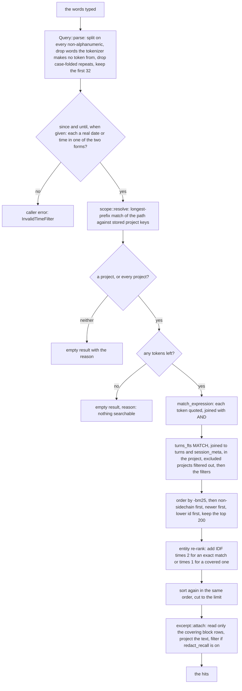
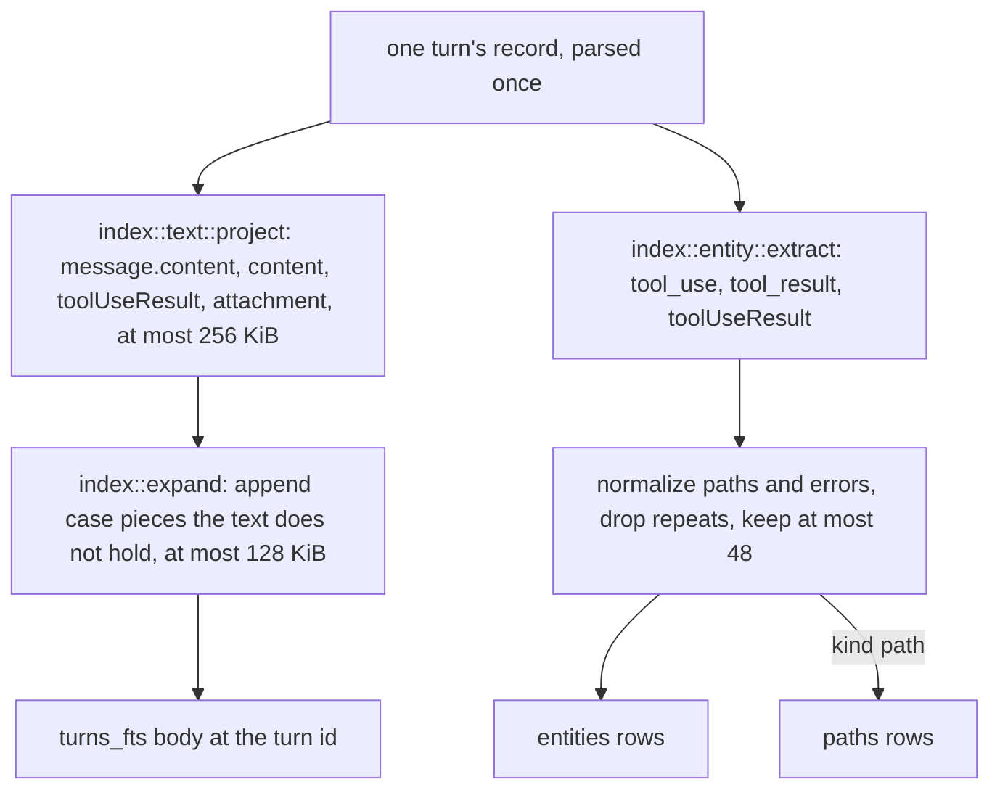

# 0005: Search

## 1. Purpose and scope

Search is how a past turn is found. It has two halves. At ingest, each turn puts its text and a set of exact-match entities into the index. At query time, a string of words becomes a quoted FTS5 expression, the matching turns are ranked by BM25 and then re-ranked by the entities they share with the query, the result is scoped to one project with every excluded project invisible, and each hit gets an excerpt cut from the archive.

This doc also covers the three terminal commands that read the archive: `terminus search`, `terminus show` and `terminus sessions`. It does not cover the MCP server that offers the same search to Claude Code, which is [0006: Recall through MCP](0006-recall-through-mcp.md), or how the prompt injection decides whether a hit is worth handing over, which is [0007: Injection](0007-injection.md).

The indexing half is called by the ingest pass in [0003: Ingest](0003-ingest.md) and by `terminus reindex`. The rows it writes are in [0004: The archive and its block rows](0004-archive-and-block-rows.md). The query half is what `terminus search`, the `recall_search` tool and the prompt injection all run, so there is one definition of relevance.

## 2. Terms

| Term | Meaning |
|---|---|
| Body | The one `turns_fts.body` value a turn gets: its projected text, then its expansion tokens. |
| Projection | The text a turn actually said, read from four parts of its record, with no JSON keys, numbers or booleans. |
| Expansion token | A camelCase or PascalCase piece of a word in the body that the body does not already hold, appended so a query for the piece finds the whole word. |
| Entity | One `(kind, value_norm)` pair in `entities`, taken from a turn's structured tool fields. The kinds are `path`, `command`, `error`, `symbol` and `tool`. |
| Query token | One piece of the typed string, split on every character that is not a letter or a digit, kept only when at least one of its characters is one the tokenizer makes a token from. |
| Exact match | A stored entity value whose tokens are exactly the query's tokens, in order. |
| Covered match | A stored entity value all of whose tokens are in the query, which asks for more besides. |
| Scope | Which project a read answers about: the directory the caller stands in, a named path, or `*` for every project. |
| Sidechain | A subagent's turn, from a session with a `parent_session_key`. |
| Excerpt | Up to `EXCERPT_CHARS`, 240, characters of a hit's text around the match, cut from the block rows, plus a `...` at either end where text was cut, so at most 246 in all. |

## 3. Crate, modules and boundaries

Indexing and querying live in the library crate, `crates/terminus-core`, under `index/` and `recall/`. The three terminal commands live in the binary crate, `crates/terminus`.

| Module | What it does |
|---|---|
| [`crates/terminus-core/src/index/mod.rs`](../../crates/terminus-core/src/index/mod.rs) | `index::project`, which builds a turn's body from the projection and the expansion tokens, and `index::entities`. Pure functions over a parsed record, with no store. |
| [`crates/terminus-core/src/index/text.rs`](../../crates/terminus-core/src/index/text.rs) | The projection, capped at `MAX_BODY_BYTES`, 256 KiB, and walked to at most `MAX_DEPTH`, 8, levels. |
| [`crates/terminus-core/src/index/expand.rs`](../../crates/terminus-core/src/index/expand.rs) | The expansion tokens, at most `MAX_EXPANSION_BYTES`, half of `MAX_BODY_BYTES`, per turn, and `separator_components`, the split the query uses too. |
| [`crates/terminus-core/src/index/entity.rs`](../../crates/terminus-core/src/index/entity.rs) | The five entity kinds, extraction from a record's tool fields, the cap of `MAX_ENTITIES_PER_TURN`, 48, and the path and error normalization. |
| [`crates/terminus-core/src/recall/mod.rs`](../../crates/terminus-core/src/recall/mod.rs) | The query layer the terminal commands and the MCP server share. Nothing in it writes, and every function takes a connection the caller opened. |
| [`crates/terminus-core/src/recall/query.rs`](../../crates/terminus-core/src/recall/query.rs) | Turns a typed string into query tokens and the FTS5 expression, and decides whether a stored entity value is an exact or a covered match. |
| [`crates/terminus-core/src/recall/unindexable.rs`](../../crates/terminus-core/src/recall/unindexable.rs) | The code points `unicode61` makes no token from, checked against the bundled SQLite by its own test. |
| [`crates/terminus-core/src/recall/search.rs`](../../crates/terminus-core/src/recall/search.rs) | One search: the filters, the ranking query, the entity re-rank and the cut to the limit. `MAX_RESULTS` and `DEFAULT_RESULTS`. |
| [`crates/terminus-core/src/recall/scope.rs`](../../crates/terminus-core/src/recall/scope.rs) | Resolves a scope to one project key by longest-prefix match against the stored keys, and lists the excluded ones. |
| [`crates/terminus-core/src/recall/excerpt.rs`](../../crates/terminus-core/src/recall/excerpt.rs) | Cuts each hit's excerpt from the block rows its turn covers, through the same projection ingest indexed. |
| [`crates/terminus/src/cmd/search.rs`](../../crates/terminus/src/cmd/search.rs) | `terminus search <words>`: parses and checks the options, then calls `recall::search::run`. |
| [`crates/terminus/src/cmd/show.rs`](../../crates/terminus/src/cmd/show.rs) | `terminus show <id>...`: a turn's archived bytes, and with `--before` or `--after`, the turns around it. |
| [`crates/terminus/src/cmd/sessions.rs`](../../crates/terminus/src/cmd/sessions.rs) | `terminus sessions`: every visible session in the scope, with its counts. |
| [`crates/terminus/src/cmd/read.rs`](../../crates/terminus/src/cmd/read.rs) | The one place the three commands open the store, always read-only. A missing store is an empty answer with a reason and exit 0, and a store that is there and cannot be read exits 1. |

The boundaries:

- **From [0003: Ingest](0003-ingest.md).** `derive.rs` calls `index::project` and `index::entities` once per turn, with the record's parsed JSON, and writes the body to `turns_fts` and the entities to `entities` and `paths`. `terminus reindex` calls the same functions, so a rebuild writes the same rows.
- **To [0004: The archive and its block rows](0004-archive-and-block-rows.md).** `turns_fts`, `entities` and `paths` are derived tables there, and a search reads `turns` and `session_meta` beside them. An excerpt reads only the block rows a turn covers, through `store/archive.rs`.
- **To [0006: Recall through MCP](0006-recall-through-mcp.md).** `recall_search` runs `recall::search::run`, the same function `terminus search` runs. `terminus show` reaches the two other functions the MCP tools use: `recall::get::records`, in [`crates/terminus-core/src/recall/get.rs`](../../crates/terminus-core/src/recall/get.rs), for the records, and `recall::context::window`, in [`crates/terminus-core/src/recall/context.rs`](../../crates/terminus-core/src/recall/context.rs), for the turns around them. 0006 describes both.
- **To [0007: Injection](0007-injection.md).** The prompt arm in `crates/terminus-core/src/inject/prompt.rs` runs `recall::search::run` scoped to the payload's `cwd`, with excerpts off. Instead of requiring every word of the prompt, it hands over candidate spellings, the paths and identifier-shaped tokens the prompt names, at most 8 of them, and a turn matching any one spelling in full is a candidate. It asks for `RANKED`, 10, hits, or `COMPACTED_RANKED`, 50, on the first prompt after a compaction. What it then does with the hits is 0007's.

## 4. Records

Search writes three derived tables at ingest and reads them, with `turns` and `session_meta`, at query time. Their columns are in [0004: The archive and its block rows](0004-archive-and-block-rows.md).

| Record | Kind | What it holds |
|---|---|---|
| `turns_fts` | Derived table, FTS5 | One row per turn, at the turn id: the body. The table is contentless, so it matches and ranks text it cannot give back, and every excerpt comes from the block rows instead. |
| `entities` | Derived table | Every entity a turn's tool fields carry, deduplicated, at most 48 per turn. |
| `paths` | Derived table | Every `path` entity again, for the `--path` filter. |

### What goes into the body

`index::text::project` reads four parts of a record and nothing else:

- `message.content`: a plain string, or an array whose `text` blocks give their text, whose `tool_use` blocks give the tool name and the string values of `input`, and whose `tool_result` blocks give their content;
- the top-level `content`, when it is a string, which is where a `system` record keeps its text;
- the top-level `toolUseResult`, the tool's output, such as `stdout` and `stderr`;
- the string values of the top-level `attachment`.

JSON keys are never emitted, and neither are numbers or booleans. The text stops at `MAX_BODY_BYTES`. Under `[capture] mode` `lean` or `minimal`, an elided `toolUseResult` or `attachment` contributes nothing.

Then `index::expand` appends expansion tokens. The table uses FTS5's default tokenizer, plain `unicode61`, with no custom tokenizer. `unicode61` makes tokens from characters in the Unicode letter, number and private-use categories and splits on everything else, so snake_case, kebab-case and path parts are already tokens of their own: a query for `worker` finds `src/worker/S.ts` and a query for `manager` finds `search_manager_new`, with nothing appended. What it splits on includes some characters Rust counts as letters, such as combining marks like U+0345 and circled letters like U+24B6, so the query drops a word made only of them. What `unicode61` does not split is a case boundary, so `SearchManager` would not be found by `manager`. For each word, the expansion appends its camelCase or PascalCase pieces, `Search` and `Manager` here, but only pieces the body does not already contain, in the order the text gives them, up to `MAX_EXPANSION_BYTES`. Digits stay with their piece, so `S3Client` gives `S3` and `Client`, and the last capital of a run starts the next piece, so `HTTPServer` gives `HTTP` and `Server`.

### What becomes an entity

`index::entity::extract` reads a record's `tool_use` and `tool_result` blocks and its top-level `toolUseResult`, and never its prose or its `attachment`:

| Kind | Where it comes from |
|---|---|
| `tool` | The name of every `tool_use` block. |
| `path` | A `tool_use` input's `file_path`, `path` or `notebook_path`; the path-shaped words of a `Bash` command; a `recall_search` call's `query` words and `paths`; and the `filePath` and nested `file.filePath` of a `toolUseResult`. Each loses surrounding quotes and a trailing `:line:col`, and is never resolved against the filesystem. |
| `command` | The program a `Bash` command runs. |
| `symbol` | The identifier-shaped tokens of a `Grep` pattern, an `Edit`'s `old_string` and `new_string`, and a `recall_search` query. |
| `error` | The text of a `tool_result` with `is_error` true, and a `toolUseResult`'s `stderr`, normalized: UUIDs become `<uuid>`, ISO-8601 timestamps `<ts>`, `0x` addresses `<addr>` and `:line:col` suffixes `:<line>`, whitespace runs become one space, and the value stops at `MAX_ERROR_BYTES`, 512. Bare integers are kept. Empty text gives no entity. |

No value is ever rejected for being common, because what counts as common changes as the archive grows and a value dropped at ingest cannot come back. Commonness is weighed at query time instead, by IDF. The cap of 48 per turn counts distinct values kept, in the order the record gives them, so a rebuild keeps the same 48.

## 5. Commands and operations

Options are in [commands.md](../commands.md#reading-the-archive), and the `--json` fields and exit codes are in [json-shapes.md](../json-shapes.md#search). All three commands open the store through `cmd/read.rs`, read-only, and never create one.

### Scope

- **Inputs:** with no `--project`, the current directory. `--project <path>` names a path inside another project, and `--project '*'` means every project.
- **Outputs:** the project key, found by a longest-prefix match of the path against the `project` and `project_pre_worktree` keys stored in `session_meta`, never by running git again, so the scope cannot disagree with what ingest stored. At equal depth, a match on a row's `project` wins over a match on its `project_pre_worktree`. The excluded projects are listed for the query to filter out, under every scope, `*` included.
- **Refusals:** each of these is an empty result with a reason and exit 0, not an error: every project is excluded, nothing is archived, no stored key covers the path, or the project it resolves to is excluded.

### `terminus search <words>`

- **Inputs:** the words, the scope, and the filters `--tool`, `--kind`, `--path`, `--since` and `--until`, with `--limit`, which defaults to 10 here and is cut to `MAX_RESULTS`, 50.
- **Outputs:** the hits, ranked as in Figure 1, each with its turn id, session, record type, time, project, whether it is a sidechain, and its excerpt. With `[privacy] redact_recall` on, the excerpts are filtered, and `--raw` prints them unfiltered for that one run. When a query is cut at 32 tokens, stderr says so.
- **Refusals:** a string with nothing searchable in it, such as pure punctuation, is an empty result with a reason. `--limit 0` exits 2.

### `terminus show <id>...`

- **Inputs:** one or more turn ids, the scope, and `--before` and `--after`, at most `MAX_CONTEXT_SIDE`, 25, each.
- **Outputs:** each turn's record, its archived bytes written to stdout as stored, through `recall::get::records`. With `--before` or `--after`, the turns around it from the same session, through `recall::context::window`, which stops at the session's ends and says which end it reached. An evicted session's record is marked as such. With `[privacy] redact_recall` on, the bytes are filtered, and `--raw` prints them unfiltered.
- **Refusals:** an id outside the scope is named on stderr. A word that is not a number exits 2.

### `terminus sessions`

- **Inputs:** the scope, `--since`, `--until` and `--limit`.
- **Outputs:** every session the scope can see, through `config::visible::sessions`, the listing every read path uses, so a session archived before its project was excluded is hidden too.
- **Refusals:** `--limit 0` exits 2.

## 6. States and workflows

### A query

*Figure 1. One search, from the words typed to the hits with their excerpts. A user's string never reaches `MATCH` as written: every token is quoted, so no FTS5 operator survives in it. The time bounds are checked before the scope is resolved, so a bound that is not a real date or time is the caller's error wherever the caller stands. The excerpts are read only for the hits that survive the cut.*

The query is a conjunction. Every token is a quoted FTS5 string and the tokens are joined with an explicit `AND`, so a query for a path such as `src/worker/S.ts`, which FTS5 would refuse as written, finds every turn holding all of its parts. The query's tokens are not expanded, because the index already holds the expansion: a query for `SearchManager` asks for that word and does not turn into a search for `manager`.

The ranking query orders candidates by `-bm25`, so the best text match is first, and breaks ties the same way every time: a turn the user watched before a sidechain turn, then the newer turn, then the lower turn id. It keeps `MAX_RESULTS` times 4, 200, candidates, so the entity re-rank has rows to move.

The re-rank reads every entity of the candidate turns. For each distinct `(kind, value_norm)` the query matches, exactly or covered, it adds `ln(1 + turns / turns_with_that_value)` times 2 for an exact match or times 1 for a covered one. A value that sits on few turns adds more than one that sits on many. The candidates are then sorted again in the same order, now on the combined score, and cut to the caller's limit. `DEFAULT_RESULTS`, 20, is the limit a request gets when its caller sets none; `terminus search` and `recall_search` each ask for 10 unless told otherwise.

Each hit also reports what the re-rank found, its entity score, its strongest match, exact or covered, and the distinct pairs it matched, because the prompt injection decides on those rather than on a score.

An excerpt reads the turn's `stream_offset` and `byte_len` from `turns`, fetches only the block rows that range covers, decompresses each once per search even when several hits share it, and runs the record through the same projection ingest indexed, so the excerpt is the turn's text and not its JSON. It is flattened to one line, windowed so the earliest place any query token appears sits a third of the way in, or at the start of the text when none does, and cut to 240 characters, with `...` where text was cut, so at most 246 characters in all. A hit whose block rows cannot be read keeps an empty excerpt and every other field: reporting damage is `terminus verify`'s job.

### Indexing one turn

*Figure 2. What one turn writes to the index during an ingest pass or a rebuild. The body and the entities both come from the same parsed record, and every rule is a function of the record's bytes alone, so the same record always writes the same rows.*

## 7. Settings

| Key | What it changes here |
|---|---|
| [`exclude`](../configuration.md#exclude) | Projects no search, show or listing returns, under every scope, `*` included, and including sessions archived before the project was excluded. |
| [`[privacy] redact_recall`](../configuration.md#privacy) | Whether excerpts and shown records are filtered on their way out. Off by default. `--raw` on `search` or `show` turns it off for that one run, and no setting or variable turns it off for the hooks or the MCP server. |
| [`[capture] mode`](../configuration.md#capture) | Under `lean` or `minimal`, text that was only in elided tool output is not in the body and is not found. |

The query limits, `MAX_QUERY_TOKENS`, `MAX_RESULTS`, the candidate pool and the entity weights, are constants, and no key changes them.
