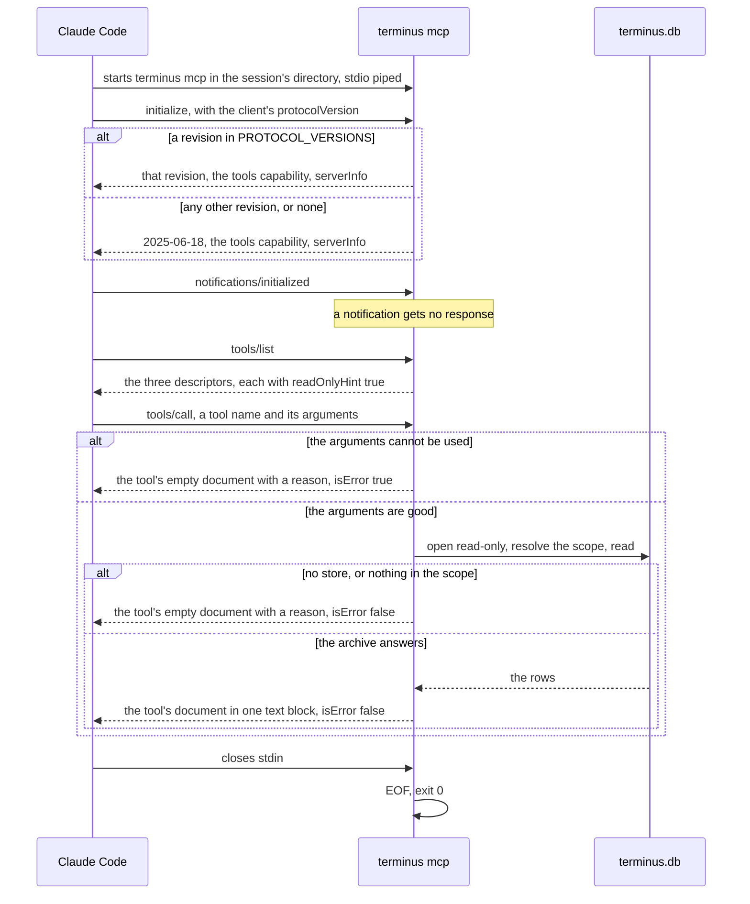
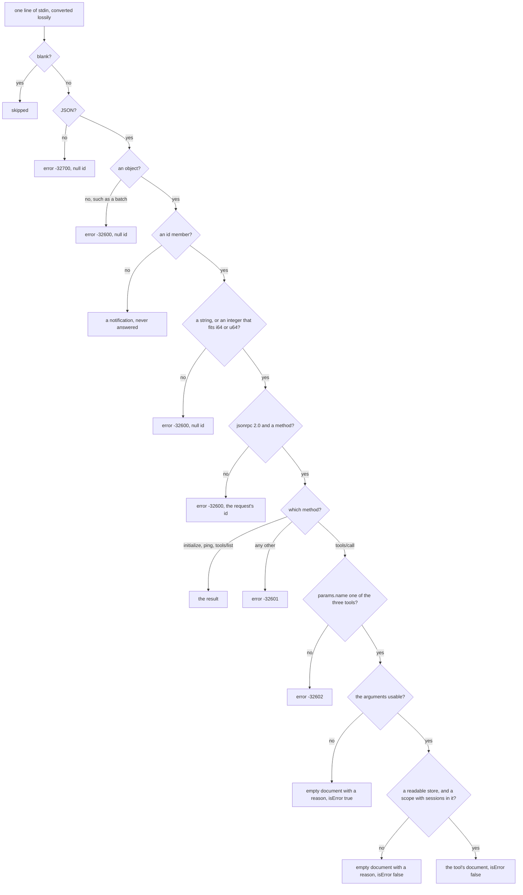

# 0006: Recall through the MCP server

## 1. Purpose and scope

Recall is how the model reaches the archive by itself, in the middle of a session. Claude Code starts `terminus mcp` as a stdio MCP server, and the server answers newline-delimited JSON-RPC 2.0 on stdin until stdin closes. It serves exactly three tools: `recall_search` finds past turns, `recall_context` returns the turns around one of them, and `recall_get` returns the archived record behind a turn id. All three read and none writes.

The server opens no port, takes no lock and starts no thread. It opens the store read-only for each tool call, not once at startup, so a session the ingest archives while the server is running is found by the next call. It reads only. It does not rank, scope or cut excerpts itself: those are the search layer's, in [0005: Search](0005-search.md), and the server is a front end over the same functions `terminus search` and `terminus show` call.

This doc also covers the egress filter, `[privacy] redact_recall`, which is applied to everything the archive hands to the model, whether it leaves through this server or through the hooks.

It takes work from Claude Code, which starts the server and sends it requests. It hands nothing on: each answer goes back to Claude Code on stdout. `terminus install`, in [0008: Install and release](0008-install-and-release.md), registers the server with Claude Code.

## 2. Terms

| Term | Meaning |
|---|---|
| Message | One line of stdin, read as bytes and converted to text lossily, so a byte that is not UTF-8 makes one malformed message and not the end of the session. A blank line is framing and is skipped. |
| Request | A message with an `id` member. It gets exactly one response line. |
| Notification | A message with no `id` member. It is never answered, whatever else it holds. |
| Protocol error | A JSON-RPC error response, `{"jsonrpc":"2.0","id":...,"error":{"code":...,"message":...}}`. The server sends one only for a message it could not route as a request. |
| Tool result | The `result` of a `tools/call`: `{"content":[{"type":"text","text":"<document>"}],"isError":<bool>}`. |
| Document | The one compact JSON object in a tool result's text block. Each tool's document has the same keys whether the call worked or not. |
| `reason` | A key of every document. A string saying why the answer is empty or smaller than asked for, or null when there is nothing to say. |
| `isError` | True when the call's arguments could not be used as given, so the model should try other arguments. False for every other answer, an empty one included. |
| Scope | Which project a call answers about: the project the server's working directory is in, a path named in `project`, or `"*"` for every project. Resolved as in [0005: Search](0005-search.md#scope). |
| Turn id | The integer that names one turn, `session_no` shifted left 24 bits and OR-ed with `turn_seq`, as in [0004: The archive and its block rows](0004-archive-and-block-rows.md). Every hit carries one, and `recall_context` and `recall_get` take them. |
| Egress filter | The rules in `observe/egress.rs` that replace credential-shaped text with a marker on its way into the model's context, when `[privacy] redact_recall` is on. |

## 3. Crate, modules and boundaries

The server lives in the binary crate, `crates/terminus`, under `cmd/mcp/`. The reads it makes and the egress filter live in the library crate, `crates/terminus-core`.

| Module | What it does |
|---|---|
| [`crates/terminus/src/cmd/mcp/mod.rs`](../../crates/terminus/src/cmd/mcp/mod.rs) | `terminus mcp`: the read loop over stdin, one response line per request, flushed per message, and the methods `initialize`, `ping`, `tools/list` and `tools/call`. `PROTOCOL_VERSIONS` and `DEFAULT_PROTOCOL_VERSION`. It denies `unwrap`, `expect`, `panic!` and slice indexing outside tests, because a panic would put a backtrace on the transport. |
| [`crates/terminus/src/cmd/mcp/rpc.rs`](../../crates/terminus/src/cmd/mcp/rpc.rs) | Classifies each message as a request, a notification or an invalid message, and builds the result and error envelopes. Hand-written over `serde_json`, with no MCP SDK and no async runtime. The four error codes it sends are `-32700`, `-32600`, `-32601` and `-32602`. |
| [`crates/terminus/src/cmd/mcp/tools.rs`](../../crates/terminus/src/cmd/mcp/tools.rs) | The three tool descriptors and their `annotations`, the argument checks, the per-call store open, and each tool's document. `MAX_HITS`, `DEFAULT_HITS`, `MAX_PATHS`, `MAX_CONTEXT_SIDE`, `DEFAULT_CONTEXT_SIDE` and `MAX_IDS`. |
| [`crates/terminus/src/cmd/read.rs`](../../crates/terminus/src/cmd/read.rs) | The read-only open and the default scope, shared with `terminus search`, `show` and `sessions`. A missing store is an answer with a reason, and a store older than the build prints one warning on stderr. |
| [`crates/terminus-core/src/recall/context.rs`](../../crates/terminus-core/src/recall/context.rs) | `recall::context::window`: the turns around an anchor, in `turn_seq` order, inside one session, with `MAX_CONTEXT_SIDE`, 25, a side. It serves `recall_context`. |
| [`crates/terminus-core/src/recall/get.rs`](../../crates/terminus-core/src/recall/get.rs) | `recall::get::records`: the archived line behind each turn id, read from only the block rows it covers, each row decompressed once per request. It serves `recall_get`. |
| [`crates/terminus-core/src/observe/egress.rs`](../../crates/terminus-core/src/observe/egress.rs) | The egress filter's eight rules and their markers, and `Redaction`, the value a caller holding the config resolves once and passes down. |

The boundaries:

- **From [0005: Search](0005-search.md).** `recall_search` runs `recall::search::run`, the function `terminus search` runs, so the ranking, the scope, the exclusion of excluded projects and the excerpts are the same. `recall_context` and `recall_get` resolve their scope through the same `recall::scope::resolve`. A turn outside the scope, or in an excluded project, is answered as a turn that is not archived, so no answer confirms that some other project holds the id.
- **To [0004: The archive and its block rows](0004-archive-and-block-rows.md).** Every read is through a read-only connection, with the store's 5 s busy timeout, beside the ingest's writes under WAL. Excerpts, context text and records are cut from the block rows through `store/archive.rs`, reading only the rows a turn covers. The server reads the derived tables, `session_meta` and the block rows, and writes nothing.
- **From [0003: Ingest](0003-ingest.md).** The ingest is the only writer. Because the server opens the store per call, what a pass archives is visible to the next call without a restart.
- **To [0007: Injection](0007-injection.md).** Injection hands archived text to Claude Code through the hooks, and it runs the same egress filter on that text with the same `Redaction`. This doc owns the filter.
- **From [0008: Install and release](0008-install-and-release.md).** [`crates/terminus/src/cmd/install/claude.rs`](../../crates/terminus/src/cmd/install/claude.rs) runs `claude mcp` to place the server's entry, and `terminus uninstall` runs it to remove the entry. The server itself never touches Claude Code's files.

## 4. Records

The server owns no table and writes no file. Its records are what crosses between it and Claude Code.

| Record | Kind | What it holds |
|---|---|---|
| The messages | Newline-delimited JSON-RPC 2.0 on stdin and stdout | One JSON value per line each way. stdout carries nothing but responses. Every diagnostic, such as the warning for a store older than the build, goes to stderr. |
| The tool result | The `result` of a `tools/call` | One text block holding the tool's document, serialized compactly, and `isError`. The document is the whole answer: there is no prose around it and no second envelope. |
| The `.mcpServers.terminus` entry | One JSON object in Claude Code's `~/.claude.json` | `{"type":"stdio","command":"<stable path>","args":["mcp"]}`, where the stable path is `~/.local/bin/terminus`. With `CLAUDE_CONFIG_DIR` set, the file is `.claude.json` in that directory. An entry already there keeps every other key it has, such as `env`. `claude` writes the entry, through `claude mcp add-json --scope user`, and Terminus reads the file and never writes it. |

## 5. Commands and operations

`terminus mcp`'s place among the commands is in [commands.md](../commands.md#terminus-mcp). The field names the tools share with `terminus search --json` and `terminus show --json` are given in [json-shapes.md](../json-shapes.md#search), and each subsection below says which ones they are.

### `terminus mcp`

Claude Code runs this. No one types it.

- **Inputs:** no arguments. Messages on stdin. The working directory Claude Code starts it in, which is the session's, and which sets the default scope.
- **Outputs:** one response line on stdout for each request, in the order the requests came, each flushed as it is written. When stdin reaches EOF, it exits 0. A write to stdout that fails means the client has gone, and it exits 0 then too. Claude Code ends a server by closing its stdin, so the server handles no signal.
- **Refusals:** any argument exits 2. A read from stdin that fails exits 1.

### Classifying a message

Before any method runs, `rpc::parse` decides what the line is. It never fails and never panics.

- **Inputs:** one non-blank line.
- **Outputs:** a request, with its `id` echoed back as the same JSON value, so `1` and `"1"` stay different ids, and its `params`, or null. Or a notification, which gets no response.
- **Refusals:** each is a protocol error.
  - A line that is not JSON gets `-32700`, with a null id.
  - JSON that is not an object gets `-32600`, with a null id. A batch is an array, so a batch gets this one error and no part of an answer.
  - An `id` that is neither a string nor an integer that fits an `i64` or a `u64` gets `-32600`, with a null id. `1.5`, `1.0`, `1e3` and `-0` are all refused, because a number read as a float would not be echoed back as the id the client sent.
  - A `jsonrpc` member that is not `"2.0"`, or a missing `method`, gets `-32600`, with the request's id.
  - A method the server does not have gets `-32601`.

### `initialize`

- **Inputs:** `params.protocolVersion`, the client's revision.
- **Outputs:** `{"protocolVersion":...,"capabilities":{"tools":{}},"serverInfo":{"name":"terminus","version":...}}`, where the version is the crate's. `PROTOCOL_VERSIONS` holds the revisions the server agrees to, newest first: `2025-11-25`, `2025-06-18`, `2024-11-05` and `2024-10-07`. A requested revision in that list is answered with itself. Any other, and a missing one, is answered with `DEFAULT_PROTOCOL_VERSION`, `2025-06-18`, the revision the tool descriptors are written against. The one capability is tools, with no `listChanged`, because the tool list is fixed when the binary is built.
- **Refusals:** none. An unknown revision is answered, not refused, and a client that cannot use the answer disconnects. `2025-03-26` is not in the list, because it is the one revision that requires JSON-RPC batching, and this server answers a batch with `-32600`.

### `ping` and `tools/list`

- **Inputs:** none.
- **Outputs:** `ping` gets an empty result, `{}`, so a liveness probe never reads as an unhealthy server. `tools/list` gets `{"tools":[...]}`, the three descriptors in the order `recall_search`, `recall_context`, `recall_get`. Each has a `name`, a one-line `description` saying what the tool returns, an `inputSchema` of type object with `additionalProperties` false, and `annotations` with `readOnlyHint` true, `destructiveHint` false, `idempotentHint` true and `openWorldHint` false. The four hints sit inside `annotations`, which is where Claude Code reads them.
- **Refusals:** none.

### `tools/call`

- **Inputs:** `params.name`, one of the three tool names, and `params.arguments`, an object. Absent or null arguments read as an empty object, so a call with none is told which argument it needed.
- **Outputs:** a tool result. The server reads only the argument names below and ignores any other key. A tool call opens the store read-only through `cmd/read.rs`; `initialize`, `ping` and `tools/list` never open it.
- **Refusals:** a missing `params.name`, or a name that is not one of the three tools, is the one protocol error a `tools/call` can get, `-32602`. Everything else a call cannot do comes back as the tool's own empty document with a `reason`:
  - With `isError` true when the arguments could not be used as given: `arguments` that is not an object, a required argument that is missing, null, blank or of the wrong JSON type, a count that is negative or not a whole number, a `limit` of 0, a time bound that is not one of the two forms, and a `kind` of `observation`.
  - With `isError` false when the archive had no answer: no store yet, a store that cannot be read, a working directory the server cannot read, nothing archived, no archived project covering the scope's path, or a scope whose project is excluded. These are answers, not mistakes to retry.

Each tool's empty document has the same keys as its full one, with every list empty, so a client reads one shape either way.

### `recall_search`

The search `terminus search` runs, with the same ranking, in [0005: Search](0005-search.md#a-query).

- **Inputs:**

  | Argument | Type | Meaning |
  |---|---|---|
  | `query` | string, required | The words, identifier, path, error line or command to find. It may not be blank. Only its first 32 tokens are used. |
  | `project` | string | A path inside one project, or `"*"` for every project. Absent means the project the server's working directory is in. |
  | `paths` | array of strings | Only turns that touched one of these files, as recorded in `paths`. At most `MAX_PATHS`, 25: a longer list is cut to its first 25. |
  | `tool` | string | Only turns using this tool, such as `Bash` or `Read`. |
  | `kind` | string | Only turns of this record type: `user`, `assistant`, `system` or `attachment`. `observation` is refused. |
  | `since` | string | Inclusive lower bound, `YYYY-MM-DD` or `YYYY-MM-DDTHH:MM:SS.mmmZ`. A bare date means the start of that day. |
  | `until` | string | Inclusive upper bound, in the same two forms. A bare date means the end of that day. |
  | `limit` | integer | How many hits, `DEFAULT_HITS`, 10, when absent. A larger number than `MAX_HITS`, 50, is lowered to 50. |

- **Outputs:** `{"hits":[...],"reason":...}`. `hits` is ranked best first. Each hit holds:

  | Key | Meaning |
  |---|---|
  | `turn_id` | The turn, to pass to `recall_context` or `recall_get`. |
  | `session_key` | The session the turn is in. |
  | `project` | The project key ingest resolved for the session, or null when the session has no `session_meta` row. |
  | `record_type` | `user`, `assistant`, `system` or `attachment`. |
  | `ts` | The turn's timestamp, or null when it has none. |
  | `sidechain` | True for a subagent's turn, which ranks below a turn the user watched at equal score. |
  | `relevance` | Higher is better: the negated BM25 score plus `entity_score`. |
  | `entity_score` | The part of `relevance` that came from the turn's entities matching the query, 0 for a match on free text alone. |
  | `excerpt` | Up to 240 characters of the turn's text around the match, cut from its block rows, filtered when `redact_recall` is on. Empty when the block rows would not give the text up. |

  `reason` is null, or one string, the first that applies: why the scope or the query gave nothing, such as a query with no searchable words; that the limit was lowered to 50; that only the first 32 tokens of the query were used; or that only the first 25 paths were filtered on.

  Every key of a hit has the same name and meaning as in the hits `terminus search --json` prints, in [json-shapes.md](../json-shapes.md#search). The terminal's hits also carry `matched_on`, and its document carries `query` and `truncated`; the tool returns none of the three, and says what `truncated` would have said in `reason`.
- **Refusals:** as in `tools/call`. The empty document is `{"hits":[],"reason":"..."}`.

### `recall_context`

The conversation around one turn, in the order it happened. It reads `recall::context::window`, the function `terminus show --before --after` reads.

- **Inputs:**

  | Argument | Type | Meaning |
  |---|---|---|
  | `turn_id` | integer, required | The anchor, from a hit. A string that holds a number is refused. |
  | `before` | integer | How many earlier turns. `DEFAULT_CONTEXT_SIDE`, 5, when absent. A number larger than `MAX_CONTEXT_SIDE`, 25, is lowered to 25. |
  | `after` | integer | How many later turns, on the same terms as `before`. |
  | `project` | string | As for `recall_search`. |

- **Outputs:** `{"turns":[...],"at_session_start":...,"at_session_end":...,"continues_from":...,"reason":...}`.

  | Key | Meaning |
  |---|---|
  | `turns` | The anchor and its neighbours, in `turn_seq` order, never timestamp order, and never past the session's first or last turn. |
  | `turns[].turn_id` | The turn. |
  | `turns[].turn_seq` | Its place in the session. |
  | `turns[].record_type` | Its record type. |
  | `turns[].tool_name` | The name of its first `tool_use` block, or null. |
  | `turns[].ts` | Its timestamp, or null. |
  | `turns[].text` | The turn's projected text from the start, flattened to one line and cut to 240 characters, filtered when `redact_recall` is on. Empty when its block rows would not give it up. |
  | `turns[].is_anchor` | True for the turn asked about. |
  | `at_session_start` | True when the window reaches the session's first turn, so there is nothing earlier in this session. |
  | `at_session_end` | True when the window reaches the session's last turn. |
  | `continues_from` | The session this one continues from, or null. It is handed back and not followed, because a session can be continued by many others, and a walk across sessions could join turns from conversations that never happened together. A caller that wants earlier turns makes a second call. |
  | `reason` | Null, why the window is empty, or that `before` or `after` was lowered to 25. |

  The document has the same keys and meanings as the `context` object `terminus show --json` prints with `--before` or `--after`, in [json-shapes.md](../json-shapes.md#show).
- **Refusals:** as in `tools/call`. An anchor that is not archived, is outside the scope, or is in an excluded project gives an empty window with the reason `no turn <id> is archived`, and `isError` false. The empty document is `{"turns":[],"at_session_start":false,"at_session_end":false,"continues_from":null,"reason":"..."}`.

### `recall_get`

The archived record behind each turn id. This is the one read that hands back the record itself rather than a projection of it.

- **Inputs:**

  | Argument | Type | Meaning |
  |---|---|---|
  | `turn_ids` | array of integers, required | The turns. It may not be empty, and every element must be an integer. A repeated id is read once, in its first place. After that, at most `MAX_IDS`, 25, are read: a longer list is cut to its first 25. |
  | `project` | string | As for `recall_search`. |

- **Outputs:** `{"records":[...],"absent":[...],"reason":...}`.

  | Key | Meaning |
  |---|---|
  | `records` | One per id that names a turn the caller may see, in the order the ids were given. |
  | `records[].turn_id` | The turn. |
  | `records[].session_key` | Its session. |
  | `records[].turn_seq` | Its place in the session. |
  | `records[].record_type` | Its record type. |
  | `records[].tool_name` | The name of its first `tool_use` block, or null. |
  | `records[].ts` | Its timestamp, or null. |
  | `records[].project` | Its session's project key, or null when the session has no `session_meta` row. |
  | `records[].body` | The record's archived line, read at the turn's `stream_offset` and `byte_len`, as a string. A byte that is not UTF-8 is replaced, because a JSON string is text; this is the one lossy rendering, and the archive keeps the bytes. With `redact_recall` on, each string inside the line is filtered and then the line itself. Null when retention evicted the session, or the block rows would not give the bytes up. |
  | `records[].body_evicted` | True when retention evicted the session's body, read from `session_meta.is_evicted` and from nothing else. A block that will not decompress leaves `body` null with this false, because that is damage for `terminus verify` to report. |
  | `absent` | One `{"turn_id":...,"reason":...}` per id that gave no record. An id that is not archived, is outside the scope, or is in an excluded project is `no turn <id> is archived`, the same reason in all three cases. When the scope itself has nothing, every id is listed with the scope's reason. |
  | `reason` | Null, or the first that applies: why the scope gave nothing; that only the first 25 ids were read; or, when there are no records at all, the first `absent` reason. |

  `records` and `absent` have the same keys and meanings as in the document `terminus show --json` prints, in [json-shapes.md](../json-shapes.md#show), where each record also carries `context`.
- **Refusals:** as in `tools/call`. The empty document is `{"records":[],"absent":[],"reason":"..."}`.

### The egress filter

An operation every model-facing read runs, not a command.

- **Inputs:** the text on its way out: a search excerpt, a context turn's text, a `recall_get` body, the brief's quotations and the per-prompt injection. `Redaction::of` reads `[privacy] redact_recall` once, at the call site that holds the config, and passes the decision down, so the shared projection code reads no config.
- **Outputs:** with the key off, the text exactly as it was cut. With it on, the text with eight rules run over it, in order: PEM private key blocks, a connection URL's userinfo, `name: value` header shapes anywhere on a line, JSON string pairs, `NAME=value` assignments, `--name value` flags, bare JSON Web Tokens, and GitHub tokens. Rules 3 to 6 fire on a name holding one of `SECRET_NAMES`, matched case-insensitively as a substring, so they take too much rather than too little. Each rule leaves a marker naming what it took out, so filtered text never reads as a turn that said less. Excerpts and context text are filtered before they are cut to length, so a secret whose label falls outside the cut is still found. A `recall_get` body is a JSON line, so `Redaction::apply_json_line` decodes and filters each string in it, then filters the line.
- **Refusals:** none. The filter never runs on the ingest path, so the archive itself is never filtered, and turning the key off returns everything as stored.

## 6. States and workflows

### One server's life

*Figure 1. One `terminus mcp` process from start to exit. The handshake always agrees on a revision. Each `tools/call` checks its arguments before it opens the store, and opens it read-only for that call alone. Every answer the server understood is a tool result, never a protocol error. Closing stdin ends the process.*

The process holds nothing between calls: no connection, no cache and no lock. A call that comes in while an ingest pass is writing reads the last committed state under WAL, and the next call reads whatever the pass has committed since.

### One message, from the line to the answer

*Figure 2. What one message becomes. The protocol errors sit on the left, for messages the server could not route. Once a `tools/call` names a tool the server has, every outcome is a tool result, and `isError` says whether the arguments or the archive explain an empty one.*

The split between `isError` true and false is the one a client acts on. True means the request could not be used as asked, and the model can retry with other arguments. False with an empty list means the archive was asked and had nothing, which is an answer. A protocol error at this level would read to Claude Code as a broken server, so it is kept for messages that are not requests at all.

## 7. Settings

| Key | What it changes here |
|---|---|
| [`[privacy] redact_recall`](../configuration.md#privacy) | Off by default. When on, every excerpt, context text and `recall_get` body the server returns goes through the egress filter. No argument and no variable turns it off for the server, because the server's answers always go to the model. |
| [`exclude`](../configuration.md#exclude) | Projects no tool returns, under every scope, `"*"` included. An id in an excluded project is answered as not archived. |

The tool limits, `MAX_HITS`, `DEFAULT_HITS`, `MAX_PATHS`, `MAX_CONTEXT_SIDE`, `DEFAULT_CONTEXT_SIDE` and `MAX_IDS`, and the list of protocol revisions are constants, and no key changes them. The server finds the data directory and `terminus.toml` from the environment Claude Code starts it in, as in [the data directory](../configuration.md#the-data-directory) and [environment variables](../configuration.md#environment-variables).
