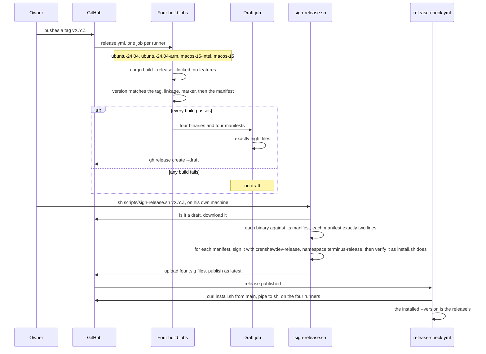
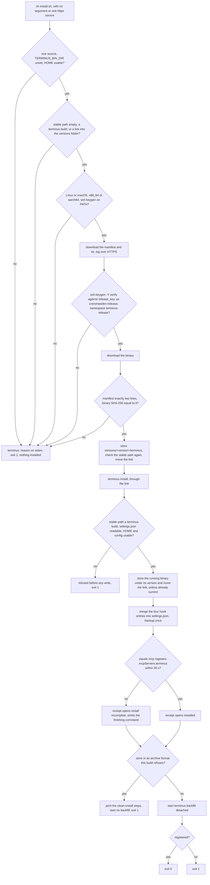

# 0008: Install and release

## 1. Purpose and scope

This part puts Terminus on a machine and wires it into Claude Code, and it builds, signs and checks the releases it installs from. It has two workflows, and both meet at `install.sh`: the release workflow reads its marker, the signing script reads its key and its version check, and the release check runs it. A release is built in CI from a version tag, signed on the owner's machine with a key CI never holds, and published. `install.sh` downloads a published release, checks its signature and its SHA-256, stores the binary under its version, points `~/.local/bin/terminus` at it, and runs `terminus install`, which writes Claude Code's wiring. An update is the same command run again.

It also covers `terminus uninstall`, which takes out what install put in, `terminus doctor`, which reports what is wired up and changes nothing, and the CI that tests every push.

It does not cover what the wiring then does. The four hook entries it writes are the hooks in [0002: Hooks](0002-hooks.md). The MCP entry it registers is the server in [0006: Recall through MCP](0006-recall-through-mcp.md). The backfill it starts last is the one in [0003: Ingest](0003-ingest.md). `terminus uninstall --purge` deletes the data directory the [0001: Overview](0001-overview.md) describes.

What every check refuses, and the release steps one at a time, are already in [release.md](../release.md) and [install.md](../install.md). This doc says how the parts fit and links there for the rest.

## 2. Terms

| Term | Meaning |
|---|---|
| Stable path | `~/.local/bin/terminus`, a symbolic link. Every hook entry and the MCP entry name it, so they are written once and never rewritten when the version changes. |
| Versions folder | `~/.local/lib/crenshawdev/terminus/versions/`, one folder per version, each holding one `terminus`. It sits outside the data directory, so `--purge` never touches it. |
| Marker | `MARKER`, a fixed string compiled into every build, `terminus-stable-binary:` and a UUID. A file at the stable path that carries it is a Terminus build and may be replaced. One that does not is someone else's and is refused. |
| Release files | For each of four platforms: the binary `terminus-<os>-<arch>`, its manifest `terminus-<os>-<arch>.manifest`, and the manifest's signature `terminus-<os>-<arch>.manifest.sig`. |
| Manifest | Exactly two lines, `version X.Y.Z` and `sha256 <64 lowercase hex digits>`, each ending in a newline. The signature covers the manifest, and the manifest covers the binary. |
| Release key | The Ed25519 SSH key `crenshawdev-release`. Its public half is the `release_key` line of `install.sh`, the only copy in the repository, and `scripts/sign-release.sh` reads it from there, as it reads `install.sh`'s `valid_version` function, and keeps no copy of either. The private half is `~/.ssh/crenshawdev-release` on the owner's machine. |
| Namespace | `terminus-release`, the `-n` value every signature is made and checked under, so a signature made with the same key for anything else does not verify. |
| Draft | A GitHub release CI has created and not published. `releases/latest` does not serve it, so `install.sh` cannot reach it. |
| Receipt | What `terminus install` prints last: every file it touched, how the MCP server was registered, the data directory, the transcript roots and the undo command. |

## 3. Crate, modules and boundaries

`install.sh` and the release scripts are POSIX shell. `terminus install`, `uninstall` and `doctor` live in the binary crate, `crates/terminus`, under `cmd/`.

| Module | What it does |
|---|---|
| [`install.sh`](../../install.sh) | The one-line installer. Pins `release_key` and the marker, makes every check before it installs anything, stores the binary, moves the link and runs `terminus install`. Its body is one brace group, so a download cut off partway runs nothing. |
| [`crates/terminus/src/cmd/install/mod.rs`](../../crates/terminus/src/cmd/install/mod.rs) | `terminus install`: every refusal before the first write, then the binary, the hook entries, the MCP registration, the advice on two Claude Code settings, the receipt, and the detached backfill last. |
| [`crates/terminus/src/cmd/install/binary.rs`](../../crates/terminus/src/cmd/install/binary.rs) | The stable path, the versions folder, the marker and the scan for it, and storing the running binary under its version and moving the link onto it. |
| [`crates/terminus/src/cmd/install/claude.rs`](../../crates/terminus/src/cmd/install/claude.rs) | Runs `claude` found on `PATH`, by absolute path, with no shell, stdin and stdout at null, `CLAUDE_CODE_DISABLE_NONESSENTIAL_TRAFFIC=1` set, and `DEADLINE`, 30 s. Reads only the exit status and the first line of stderr. |
| [`crates/terminus/src/cmd/install/json_file.rs`](../../crates/terminus/src/cmd/install/json_file.rs) | Reads and writes one Claude Code settings file, keeping every key in its order and every scalar as the text it was. A file already in the two-space form it writes has no other byte changed; any other file is rewritten in full in that form, with the original in the one-time backup. The one-time `.terminus-backup`. Re-reads the file immediately before writing and writes through a temporary and a rename. |
| [`crates/terminus/src/cmd/install/targets.rs`](../../crates/terminus/src/cmd/install/targets.rs) | Where `settings.json` and `.claude.json` are, the exact hook entry and MCP entry, the merge rule, and the `claude mcp` commands that finish a registration by hand. |
| [`crates/terminus/src/cmd/uninstall.rs`](../../crates/terminus/src/cmd/uninstall.rs) | `terminus uninstall [--purge] [-y]`: removes the hook entries, the MCP entry and the link, restores the backup when only Terminus's entries changed, and with `--purge` deletes the data directory under `LOCK`. |
| [`crates/terminus/src/cmd/doctor.rs`](../../crates/terminus/src/cmd/doctor.rs) | `terminus doctor`: 14 checks, each with a state, a one-line finding and, where there is one, the command that fixes it. Writes nothing on any path. |
| [`.github/workflows/release.yml`](../../.github/workflows/release.yml) | On a version tag: four builds, one per platform on its own runner, then one draft holding exactly the eight files. |
| [`.github/workflows/release-check.yml`](../../.github/workflows/release-check.yml) | On a published release: installs it with the public one-line command on the same four runners and checks the installed version. |
| [`.github/workflows/test.yml`](../../.github/workflows/test.yml) | On every push and pull request: the whole suite on the four runners, in a debug and a release build each. |
| [`.github/workflows/fast.yml`](../../.github/workflows/fast.yml) | On every pull request and every push to main: sentinel's fast check, copied from sentinel and run from its submodule at `.sentinel`. A push to main runs only its mechanical job. |
| [`scripts/sign-release.sh`](../../scripts/sign-release.sh) | Run by the owner on his own machine: checks a draft, signs its four manifests, verifies each signature the way `install.sh` will, uploads them and publishes the release as latest. |

The boundaries:

- **To [0002: Hooks](0002-hooks.md).** `terminus install` writes one exec-form entry per name in `EVENTS` into `settings.json`, reading the same list the hook's parse reads, so the file cannot come to hold an event the binary rejects. Each entry runs the stable path with `["hook","<event>"]`.
- **To [0006: Recall through MCP](0006-recall-through-mcp.md).** `terminus install` reads `.claude.json`, and when `.mcpServers.terminus` is not already `{"type":"stdio","command":"<stable path>","args":["mcp"]}`, it runs `claude mcp add-json --scope user terminus`, after `claude mcp remove --scope user terminus` when an entry in another shape is there. `terminus uninstall` runs the remove. Terminus never writes `.claude.json` itself.
- **To [0003: Ingest](0003-ingest.md).** The last thing `terminus install` does is start `terminus backfill` detached, through the stable path, so the archive fills in after install has returned.
- **To [0001: Overview](0001-overview.md) and [0004: The archive and its block rows](0004-archive-and-block-rows.md).** `terminus install` prints the data directory and refuses to start a backfill into a store in an archive format the build refuses. `terminus uninstall --purge` takes `LOCK` and deletes the data directory. `terminus doctor` opens the store read-only.

## 4. Records

This part owns no table. It writes files outside the data directory, and the release files on GitHub.

| Record | Kind | What it holds |
|---|---|---|
| The hook entries | Four JSON objects in Claude Code's `settings.json` | `{"type":"command","command":"<stable path>","args":["hook","<event>"]}`, each in a group of its own with `matcher: ""` under `.hooks.<event>`, appended after any group already there. The file is `$CLAUDE_CONFIG_DIR/settings.json`, or `~/.claude/settings.json` without it. An entry is Terminus's when its `command` is the stable path, and an entry of Terminus's in the wrong shape is repaired in place, keeping its position and any key beside it. Every other entry is never read or written. The full shape is in [0002: Hooks](0002-hooks.md#4-records). |
| `settings.json.terminus-backup` | File beside the resolved `settings.json` | The file's bytes before the first install that changed it. Written once, through a temporary and a link that cannot replace an existing backup, so a later install never overwrites it. `terminus uninstall` restores it when nothing but Terminus's entries changed since. |
| The versions folder | `~/.local/lib/crenshawdev/terminus/versions/<version>/terminus` | One stored binary per version. An upgrade adds a folder and deletes none, so a session or ingest already running keeps the file it started from. A rebuild at the same version is renamed over that version's file, and a process running the old one keeps its inode. Neither `uninstall` nor `--purge` deletes the folder. |
| The stable link | `~/.local/bin/terminus` | A symbolic link to one stored binary. Moving it is how a version changes. Nothing edits `PATH` or a shell profile to add `~/.local/bin`. |
| The MCP entry | `.mcpServers.terminus` in `~/.claude.json` | Written by `claude`, as [0006: Recall through MCP](0006-recall-through-mcp.md#4-records) describes. |
| The release files | Eight files in a draft, then twelve in a published release | `terminus-<os>-<arch>` and `terminus-<os>-<arch>.manifest` for `linux-x86_64`, `linux-aarch64`, `macos-x86_64` and `macos-aarch64`, from CI, and the four `terminus-<os>-<arch>.manifest.sig` from the owner's machine. |

## 5. Commands and operations

Options are in [commands.md](../commands.md#setup), and `doctor`'s `--json` fields in [json-shapes.md](../json-shapes.md#doctor). The installer's behaviour is in [install.md](../install.md), and every release and installer check in [release.md](../release.md).

### `install.sh`

- **Inputs:** no argument, which downloads from `https://github.com/jcrenshaw-dev/terminus/releases/latest/download`, or one `https://` source. `HOME`, `uname -s` and `uname -m`, `curl`, `ssh-keygen`, and `sha256sum` or `shasum -a 256`.
- **Outputs:** in the order [release.md](../release.md#what-installsh-checks) lists: the environment and the stable path are checked, the manifest and its signature are downloaded, and the manifest is verified with `ssh-keygen -Y verify -I crenshawdev-release -n terminus-release` against an allowed-signers file the script writes from `release_key`, so no allowed-signers file of the user's is read. Only then is the binary downloaded, the manifest's two lines checked, and the binary's SHA-256 compared with the manifest's. Then the binary is stored as `~/.local/lib/crenshawdev/terminus/versions/<version>/terminus` through a temporary and a rename, the stable path is checked again, a new link is made beside it and renamed over `~/.local/bin/terminus`, the versions present are printed, and `terminus install` runs through the link. The script exits with its status.
- **Refusals:** every check refuses with `terminus: <reason>` on stderr and exit 1, with nothing installed. Among them, `TERMINUS_BIN_DIR` set, because `terminus install` would point the wiring into that folder while the script links `~/.local/bin/terminus`; a `HOME` that is unset, relative, not UTF-8, has a path part that is exactly `..`, or changes when the shell copies it; a stable path holding a folder or a file that does not carry the marker; and a manifest that does not verify against the pinned key. Nothing overrides the key.

### `terminus install`

- **Inputs:** no arguments, and stdin is never read. The stable path, the versions folder, `terminus.toml`, the data directory, and Claude Code's `settings.json` and `.claude.json`.
- **Outputs:** in this order.
  1. Every check that can refuse runs before the first write: what sits at the stable path, `HOME`, the config, the data directory and `settings.json`.
  2. The running binary is stored under its own version in the versions folder, and the stable link is moved onto it. When it is already running from the file the link names, as it is after `install.sh`, nothing is written. So `target/release/terminus install` installs a local build the same way.
  3. The four hook entries are merged into `settings.json`. When the file existed and is about to change, `settings.json.terminus-backup` is written first, once. A file that only differs in formatting is not rewritten.
  4. The MCP entry is registered through `claude mcp`, with the 30 s deadline and `CLAUDE_CODE_DISABLE_NONESSENTIAL_TRAFFIC=1`, so `claude` opens no connection. An entry already current runs no `claude` at all.
  5. It reports `cleanupPeriodDays` and `autoCompactEnabled` and changes neither.
  6. It prints the receipt.
  7. It starts `terminus backfill` detached, from the stable path, and returns without waiting.
- **Refusals:** before any write, a file at the stable path that does not carry the marker, a `settings.json` that cannot be read or is not JSON, and an unusable `HOME` or config exit 1 with nothing changed. After the writes, a registration that did not complete, because `.claude.json` cannot be read, `claude` is not on `PATH`, cannot start, runs past 30 s or exits non-zero, leaves everything else done, opens the receipt with `install incomplete: the mcp server is not registered`, prints the command that finishes it, and exits 1. A store in an archive format the build refuses prints the refusal with the clean-install steps, starts no backfill, and exits 1. Any argument, `--yes` and `--json` included, exits 2.

### `terminus uninstall`

- **Inputs:** `--purge` and `-y` or `--yes`.
- **Outputs:** every hook entry whose `command` is the stable path is removed from `settings.json`, under every event key, with any group left empty. An event key left empty is removed only when the backup shows it was not there before install. Then the file is compared with the backup as values: when they are equal, the backup's bytes go back and the backup is deleted, and when the user has edited the file since, the edited file and the backup both stay. The MCP entry is removed with `claude mcp remove --scope user terminus`, only when `.claude.json` holds one. The stable link is removed. The versions folder and the data directory stay, and both paths are printed. With `--purge`, it shows the data directory's path and size, asks once with no as the default, takes `LOCK`, and deletes the directory. `-y` answers yes, and does nothing without `--purge`.
- **Refusals:** a step that cannot be done is reported and the rest still happen, then it exits 1. With `--purge`, no answer to read, or an ingest pass holding `LOCK`, deletes nothing and exits 1. An old `.claude.json.terminus-backup` is left and its path printed, because restoring it would roll back Claude Code's own state. `--json` exits 2.

### `terminus doctor`

- **Inputs:** `--json`.
- **Outputs:** 14 checks, always the same keys: the binary at the stable path and its version, `settings.json`, each of the four hook entries, the MCP entry, the `claude` command and its version, the transcript roots, the data directory, the store, the last `runs` row, `cleanupPeriodDays` and `autoCompactEnabled`. Each is `ok`, `note`, `unknown` or `problem`, with one line of finding and, where one exists, a command that fixes it, which for most of them is `terminus install`. It runs `--version` on the stable binary and on `claude`, each bounded at 2 s and each with `CLAUDE_CODE_DISABLE_NONESSENTIAL_TRAFFIC=1`. It opens the store read-only and reads `settings.json` only for the keys it checks, and it never prints the file.
- **Refusals:** none. It writes nothing on any path and repairs nothing. It exits 1 only when a check is a `problem`.

### Pushing a version tag

- **Inputs:** a tag `v<X.Y.Z>` pushed to the repository. Nothing else starts `release.yml`.
- **Outputs:** four build jobs, one per platform on its own runner: `ubuntu-24.04` for `x86_64-unknown-linux-musl`, `ubuntu-24.04-arm` for `aarch64-unknown-linux-musl`, `macos-15-intel` for `x86_64-apple-darwin` and `macos-15` for `aarch64-apple-darwin`. Each builds with `cargo build --release --locked -p terminus` and no features, checks that `--version` matches the tag, that a Linux binary is statically linked and a macOS binary links nothing outside `/usr/lib/`, and that the binary carries the marker read from `install.sh`, then writes the manifest. When all four pass, the draft job checks it holds exactly the eight files and creates the release as a draft.
- **Refusals:** any failed check fails its job, and one failed build leaves no draft. The workflow has `contents: read`, and only the draft job has `contents: write`, with the workflow's own token. No workflow names a signing key.

### `scripts/sign-release.sh v<X.Y.Z>`

- **Inputs:** the tag, the owner's `gh` login, `~/.ssh/crenshawdev-release`, and `install.sh`'s one `release_key` line and one `valid_version` function.
- **Outputs:** it checks the tag's version with `install.sh`'s `valid_version`, so it refuses exactly the versions the installer refuses, then downloads the draft, checks every binary against its manifest and every manifest's exact two lines before it signs anything, signs each manifest with `ssh-keygen -Y sign -n terminus-release` and verifies its signature with the command `install.sh` runs before it signs the next, uploads the four `.sig` files, and publishes the release as latest. Publishing with the owner's own login is what starts `release-check.yml`, because a release published with a workflow's token starts no other workflow.
- **Refusals:** a tag that does not start with `v` or whose version `valid_version` rejects, a release that is not a draft, a draft missing any of the eight files, a binary whose SHA-256 is not its manifest's, a manifest not exactly the two lines, a signature that does not verify, and a failed upload or publish all stop it, and the release stays a draft.

### The CI runs

- **`release-check.yml`**, on `release: published`. On `ubuntu-24.04`, `ubuntu-24.04-arm`, `macos-15-intel` and `macos-15`, it puts a stand-in `claude` that exits 0 on `PATH`, runs `curl -fsSL https://raw.githubusercontent.com/jcrenshaw-dev/terminus/main/install.sh | sh` with pipefail, and checks that `~/.local/bin/terminus --version` is the release's version.
- **`test.yml`**, on every push and pull request. On the same four runners, in a debug and a release build each, eight jobs, it runs `cargo test --workspace --all-features --locked`, with a 15-minute limit on the test step that prints the processes and their open files before it stops a hung run. It reads no secret. Three timing tests of a hook spawn's p99 are skipped on every runner, and three budgets on a single spawn on the two macOS runners, because a hosted VM's timing measures the VM.
- **`fast.yml`**, on every pull request and every push to main. Sentinel's fast check: a mechanical job that installs sentinel's gating tools and runs its checks, and on a GitHub pull request a security review of the diff, posted as a pull request comment. A push to main runs only the mechanical job. The review job reads the `ANTHROPIC_API_KEY` secret and is skipped for Dependabot. This is the repository's CI. The binary calls no model and reads no key.

## 6. States and workflows

### A release

*Figure 1. One release, from the tag to the check. CI builds and drafts with no key. The owner signs and publishes from his own machine, and only a draft is signed. Publishing starts `release-check.yml`, which installs the release with the public command on every platform it ships for.*

The key and the build never meet. CI holds no signing key, and the owner's machine builds nothing: it checks what CI built against what CI wrote down, signs the manifest and not the binary, and checks its own signature with the same command every user's `install.sh` runs. A signature therefore says the owner's key approved this manifest under `terminus-release`, and the manifest's `sha256` line ties that approval to one binary. What that protects and what it does not is in [release.md](../release.md#what-the-signature-protects).

### An install

*Figure 2. One install, from the script's first check to `terminus install`'s exit. Every refusal in `install.sh` comes before anything is installed, and the binary is downloaded only after the manifest's signature has verified. Every refusal in `terminus install` comes before its first write. After that, only the registration and a refused archive format can make it exit 1, and both are reported with what to do.*

An update is this same flowchart. The new version gets a folder of its own beside the old ones and the link moves to it. The hook entries and the MCP entry name the stable path, so `terminus install` finds them current and writes neither. There is no version floor, so an older release that the key signed installs the same way.

## 7. Settings

Install reads no `terminus.toml` key of its own. `roots` is listed in the receipt and is what the backfill walks, but where the hook entries go is Claude Code's settings file, which `CLAUDE_CONFIG_DIR` picks. What the installer needs is in [install.md](../install.md#what-it-needs), and every variable below is in [configuration.md](../configuration.md#environment-variables).

| Variable | What it changes here |
|---|---|
| `TERMINUS_BIN_DIR` | `install.sh` refuses to run while it is set. `terminus install`, `uninstall` and `doctor` read it as the stable path's folder in place of `~/.local/bin`, which is what keeps a test off the real stable path. The versions folder stays under `HOME` either way. |
| `HOME` | Where the stable path and the versions folder are. Both `install.sh` and `terminus install` require it to be set and absolute. |
| `CLAUDE_CONFIG_DIR` | When set, the hook entries go in `$CLAUDE_CONFIG_DIR/settings.json` and the MCP entry in `$CLAUDE_CONFIG_DIR/.claude.json`. It is passed through to `claude`, so `claude` writes the file install read. |
| `TERMINUS_DATA_DIR`, `TERMINUS_CONFIG_DIR` | The data directory the receipt prints, the backfill fills and `--purge` deletes, and where `terminus.toml` is read from, as in [the data directory](../configuration.md#the-data-directory). |
| `PATH` | Where `claude` is found. Its absolute path is what runs. |
| `CLAUDE_CODE_DISABLE_NONESSENTIAL_TRAFFIC` | Never read. Set to `1` on every `claude` process install and uninstall start and on every `--version` doctor runs, so `claude mcp` opens no network connection. |
