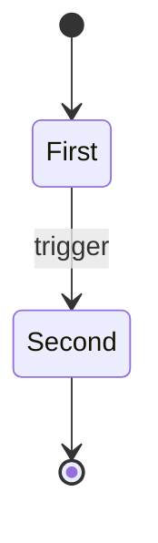
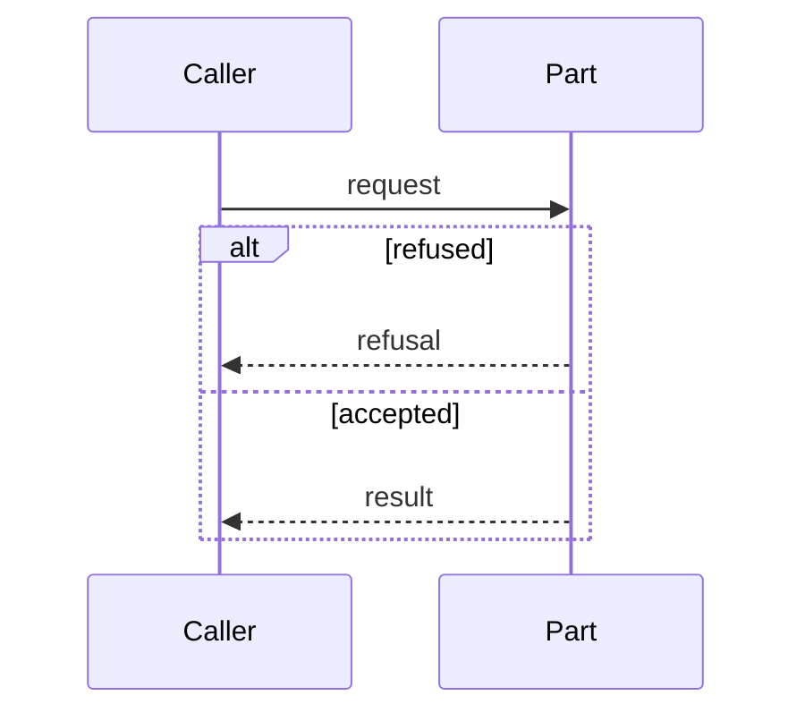

# NNNN: Title

The current design of this part of Terminus, and nothing else. When the design changes, the doc is edited in place and git holds the history. It never tracks work. Every section keeps its heading, and a section with nothing to say for this part says why in one sentence.

## 1. Purpose and scope

What this part does, and what it does not do. Which parts it takes work from and which it hands work to, named by doc number.

## 2. Terms

Each term this doc uses in a sense of its own, in the words the code uses for it.

| Term | Meaning |
|---|---|
| | |

## 3. Crate, modules and boundaries

The crate this part lives in, then each module or file that makes it, by its full repo-relative path and linked relative to this doc, such as [`crates/terminus-core/src/config.rs`](../../crates/terminus-core/src/config.rs). Code is never cited by line number, because a line number goes stale on the next edit.

| Module | What it does |
|---|---|
| | |

Then the boundary to each other part this one talks to: what crosses it, in which direction, and a link to that part's doc.

## 4. Records

The tables and files this part writes, and what each one holds. A file is named by where it sits under the data directory. The columns of every table are given once, in the schema in 0004, and the other docs link there rather than repeat them.

| Record | Kind | What it holds |
|---|---|---|
| | | |

## 5. Commands and operations

One subsection for each command and operation this part owns. Options are in [commands.md](../commands.md), and the `--json` fields and exit codes are in [json-shapes.md](../json-shapes.md). Link to them, don't restate them.

### operation-name

- **Inputs:**
- **Outputs:**
- **Refusals:**

## 6. States and workflows

The diagrams for this part. Each one is hand-written Mermaid in a `mermaid` fence, of one of four types, picked by the question it answers:

| Question the diagram answers | Diagram |
|---|---|
| How the parts connect, and which way the data goes | `flowchart` |
| Who does what, in what order, across actors, with `alt` for branches | `sequenceDiagram` |
| What states a record passes through | `stateDiagram-v2` |
| What the stored data looks like | `erDiagram` |

A caption line goes directly under each diagram, in the form below, numbered in order through the doc. No diagram sets a `%%{init` line, `style`, `classDef` or a fill, so GitHub themes it for light and dark.

*Figure 1. The states a record passes through, and what moves it from one to the next.*

*Figure 2. How one request moves from the caller through this part, with the refused and the accepted branch.*

## 7. Settings

The keys in `terminus.toml` that change how this part behaves. Each key links its entry in [configuration.md](../configuration.md), which gives its default and its full effect. A part with no key of its own says so in one sentence.

| Key | What it changes here |
|---|---|
| | |
